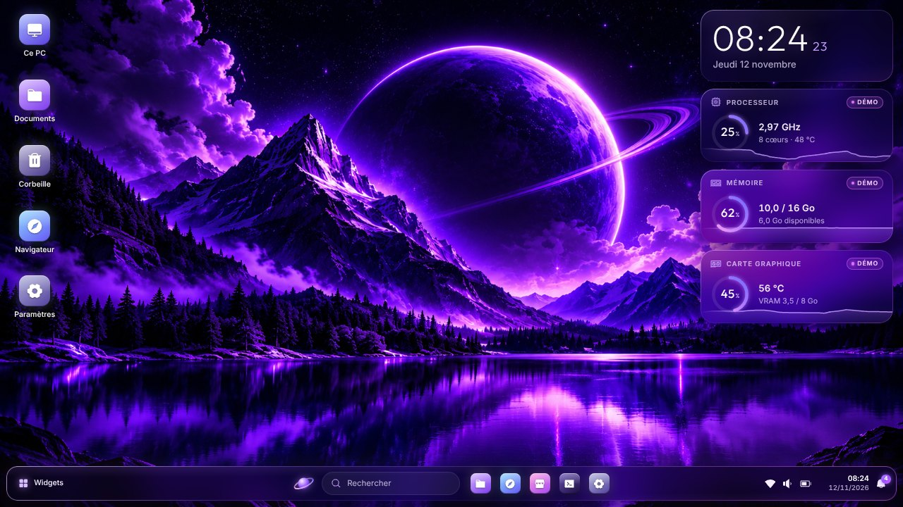
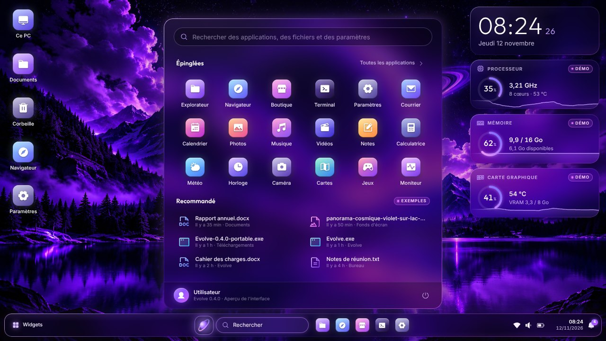
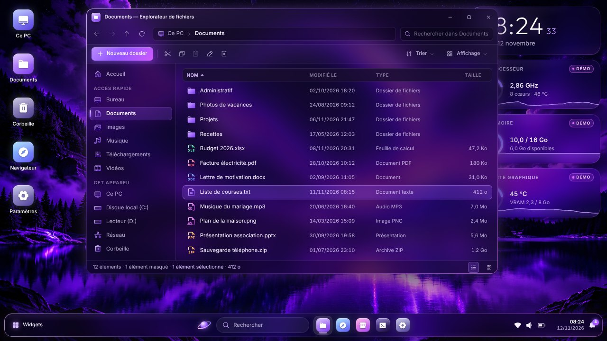
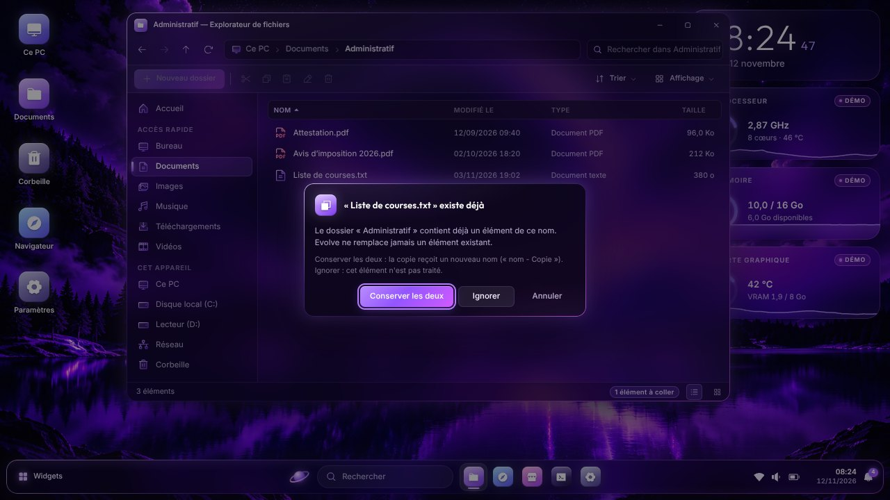
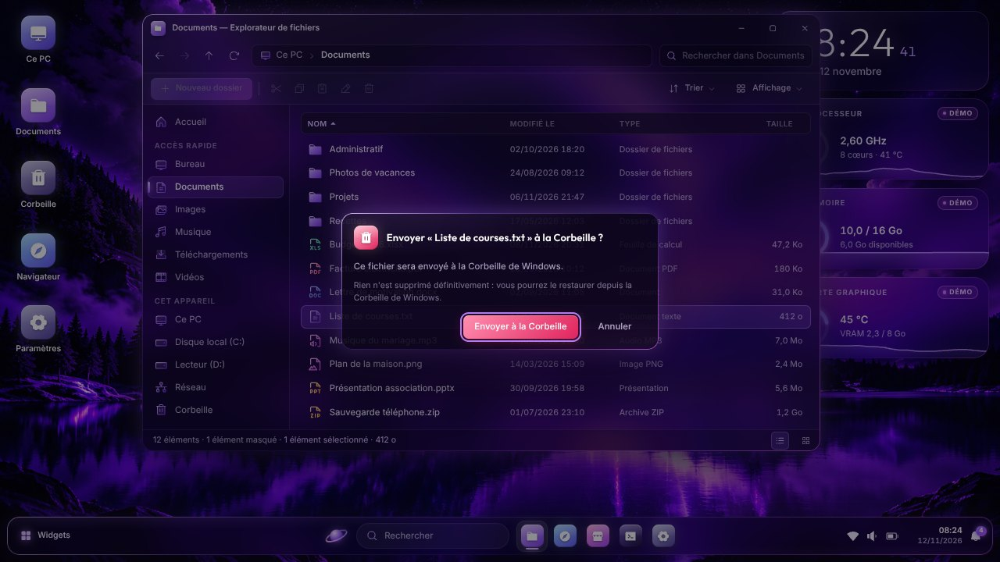

# Evolve

**Evolve** est un environnement de bureau au style néon violet : bureau, barre des tâches, menu Démarrer, fenêtres, explorateur de fichiers.

Cette version 0.4.1 reste un **aperçu de l'interface graphique**, mais son **explorateur de fichiers agit désormais réellement sur vos fichiers** : il crée des dossiers, renomme, copie, déplace, envoie à la Corbeille de Windows et ouvre un fichier avec son application habituelle. Trois règles ne souffrent aucune exception : **rien n'est supprimé définitivement**, **rien n'est remplacé**, et tout déplacement, tout envoi à la Corbeille, toute ouverture d'un programme sont **confirmés par vous**. Evolve prend la forme d'un simple fichier `.exe` portable pour Windows : il s'ouvre comme une application ordinaire, sans installation, et ne modifie aucun réglage de Windows. Ce qu'il écrit de lui-même sur le PC se limite à un petit fichier de réglages et à des fichiers temporaires, [détaillés plus bas](#ce-quevolve-fait--et-ne-fait-pas--sur-votre-pc).



| Menu Démarrer | Explorateur de fichiers |
| :---: | :---: |
|  |  |

*Captures réalisées sur un disque de démonstration.*

## Sommaire

- [Télécharger et lancer Evolve](#télécharger-et-lancer-evolve)
- [Ce qu'Evolve fait — et ne fait pas — sur votre PC](#ce-quevolve-fait--et-ne-fait-pas--sur-votre-pc)
- [L'explorateur de fichiers](#lexplorateur-de-fichiers)
- [Vos réglages](#vos-réglages)
- [Ce que contient cet aperçu](#ce-que-contient-cet-aperçu)
- [Raccourcis utiles](#raccourcis-utiles)
- [Vérifications automatiques](#vérifications-automatiques)
- [Limites connues](#limites-connues)
- [Développement](#développement)
- [Crédits et licences](#crédits-et-licences)

## Télécharger et lancer Evolve

L'exécutable est fabriqué automatiquement par GitHub à chaque modification du code.

1. Connectez-vous à GitHub, puis ouvrez la page **[Actions → Exécutable Windows](https://github.com/leoblanchart92-hub/Evolve/actions/workflows/build-windows.yml)**.
2. Cliquez sur l'exécution la plus récente marquée d'une coche verte.
3. En bas de la page, dans la rubrique **Artifacts**, cliquez sur **`Evolve-0.4.1-portable.exe`** : le fichier (environ 140 Mo) se télécharge tel quel, sans archive à décompresser.
4. Double-cliquez sur le fichier téléchargé. Evolve s'ouvre en plein écran.

À savoir :

- **Avertissement de Windows.** Le fichier n'est pas signé numériquement (une signature est payante). Le navigateur peut donc signaler un fichier « rarement téléchargé », et Windows afficher « Windows a protégé votre ordinateur » : cliquez sur *Informations complémentaires*, puis sur *Exécuter quand même*.
- **Démarrage.** Au lancement, le fichier se décompresse dans le dossier temporaire avant d'afficher quoi que ce soit : comptez quelques secondes sans rien à l'écran. Il est inutile de le lancer une seconde fois.
- **Quitter.** Menu Démarrer → bouton d'alimentation (en bas à droite du menu) → *Quitter Evolve*, ou `Alt` + `F4`.
- **Durée de disponibilité.** GitHub conserve chaque exécutable 90 jours. Passé ce délai, il suffit d'une nouvelle compilation pour en obtenir un autre.

Configuration requise : Windows 10 ou 11, 64 bits.

## Ce qu'Evolve fait — et ne fait pas — sur votre PC

| Engagement | En pratique |
| --- | --- |
| **Aucune installation** | Rien n'est ajouté au menu Démarrer de Windows, au bureau, à la liste des programmes ni au démarrage de l'ordinateur. Pour « désinstaller » Evolve, supprimez le fichier `.exe` et, si vous avez modifié des réglages, le dossier `%APPDATA%\Evolve`. |
| **Aucun droit administrateur** | Evolve s'exécute avec les droits de l'utilisateur et ne demande jamais pour lui-même l'élévation de Windows : ce point est contrôlé à chaque compilation. Depuis que l'explorateur agit sur les fichiers, deux situations peuvent néanmoins faire apparaître la demande d'autorisation de Windows, et c'est alors Windows qui vous pose la question : l'ouverture d'un programme qui exige lui-même ces droits, et l'envoi à la Corbeille d'un élément réservé aux administrateurs (voir les [limites connues](#limites-connues)). |
| **Vos fichiers : modifiés seulement à votre demande** | L'explorateur n'agit que lorsque vous le lui demandez — nouveau dossier, renommer, copier, déplacer, envoyer à la Corbeille, ouvrir — et jamais de lui-même. Rien n'est supprimé définitivement : « supprimer » envoie à la Corbeille de Windows, d'où vous pouvez restaurer. Rien n'est remplacé : devant un nom déjà pris, vous choisissez de conserver les deux éléments ou d'ignorer — et c'est Windows lui-même qui refuse de renommer ou de déplacer vers un nom pris, même s'il vient de l'être par un autre programme. Déplacer, envoyer à la Corbeille et ouvrir un programme — ou un fichier d'un type inconnu d'Evolve — exigent votre confirmation. Les lecteurs, vos dossiers personnels eux-mêmes et les dossiers du système ne peuvent être ni renommés, ni déplacés, ni supprimés. Evolve n'examine jamais le contenu de vos fichiers, et ce que vous consultez n'est ni enregistré ni transmis. Un dossier personnel absent — Documents compris — est annoncé comme introuvable, jamais recréé (voir [L'explorateur de fichiers](#lexplorateur-de-fichiers)). Ces points sont contrôlés à chaque compilation. |
| **Aucun réglage de Windows modifié** | Les paramètres rapides (Wi-Fi, Bluetooth, volume, luminosité…) sont purement visuels : ils n'agissent que sur l'interface d'Evolve, qui retient leur position sans rien changer à Windows. |
| **Un seul dossier dans votre profil** | De lui-même, Evolve n'y range que vos réglages : le fichier `%APPDATA%\Evolve\settings.json` (voir [Vos réglages](#vos-réglages)). Il n'est créé qu'au premier réglage modifié : tant que vous ne changez aucun réglage et ne demandez aucune opération à l'explorateur, Evolve n'écrit rien dans votre profil. Ces deux points sont contrôlés à chaque compilation. |
| **Aucune mesure réelle du matériel** | Les widgets processeur, mémoire et carte graphique affichent des valeurs simulées, signalées par la mention « DÉMO ». |
| **Aucune connexion réseau** | L'interface est entièrement locale ; toute requête vers Internet y est bloquée. |

**Fichiers temporaires.** En dehors du fichier de réglages décrit ci-dessous, Evolve n'utilise que le dossier temporaire de Windows (`%TEMP%`) :

| Dossier dans `%TEMP%` | Contenu | Taille | Durée de vie |
| --- | --- | --- | --- |
| `Evolve-portable` | l'application décompressée | environ 315 Mo | créé au lancement, supprimé à la fermeture |
| `ns….tmp` (nom variable) | dossier de travail du lanceur | moins de 1 Mo | créé au lancement, supprimé à la fermeture |
| `Evolve` | cache technique du moteur d'affichage | environ 3 Mo | conservé d'un lancement à l'autre |

Ces dossiers peuvent être supprimés sans risque lorsqu'Evolve est fermé. Leur taille et leur suppression à la fermeture sont relevées à chaque compilation (voir [Vérifications automatiques](#vérifications-automatiques)).

## L'explorateur de fichiers

L'explorateur d'Evolve parcourt les vrais dossiers de l'ordinateur et, depuis la version 0.4.0, **agit réellement sur vos fichiers**, à votre demande.

Ce qu'il affiche :

- **Accueil** et **Ce PC** — vos six dossiers personnels (Bureau, Documents, Téléchargements, Images, Musique, Vidéos), là où Windows les range réellement, même déplacés vers OneDrive, et les lecteurs locaux avec leur espace libre.
- **Le contenu de chaque dossier** — nom, type, taille et date de modification, en grandes icônes ou en vue « Détails », triable par colonne.
- **La navigation habituelle** — double-clic, fil d'Ariane cliquable (les premiers dossiers d'un long chemin se replient dans « … »), précédent, suivant, dossier parent, actualisation, recherche dans le dossier affiché, sélection et déplacement au clavier.
- **Les éléments masqués** — fichiers du système, `AppData`, `desktop.ini`… restent cachés, comme dans l'Explorateur de Windows ; *Affichage → Éléments masqués* les montre, estompés.

Ce qu'il fait, à votre demande :

| Opération | Comment la demander | Ce qui se passe |
| --- | --- | --- |
| **Nouveau dossier** | bouton *Nouveau dossier*, clic droit dans le dossier, `Ctrl` + `Maj` + `N` | Le nom vous est demandé, puis le dossier est créé dans le dossier affiché. |
| **Renommer** | bouton, clic droit, `F2` | Le nom actuel est proposé, prêt à être remplacé. Un nom déjà pris est refusé : l'élément garde son nom. |
| **Copier, puis coller** | boutons, clic droit, `Ctrl` + `C` puis `Ctrl` + `V` | Les éléments sont copiés dans le dossier affiché, dossiers entiers compris. Collés dans leur propre dossier, ils sont dupliqués (« nom - Copie »). |
| **Couper, puis coller** | boutons, clic droit, `Ctrl` + `X` puis `Ctrl` + `V` | Rien ne bouge avant *Coller* ; après votre confirmation, les éléments sont déplacés. `Échap` retire d'abord la sélection ; une seconde fois, il renonce au déplacement. |
| **Envoyer à la Corbeille** | bouton, clic droit, `Suppr` | Après votre confirmation, les éléments rejoignent la Corbeille de Windows. |
| **Ouvrir** | double-clic, clic droit, `Entrée` | Un dossier s'ouvre dans l'explorateur ; un fichier est confié à l'application que Windows lui associe, comme lors d'un double-clic dans l'Explorateur de Windows. Un document, une image, un son, une vidéo ou une archive s'ouvre directement ; tout autre fichier, seulement après votre confirmation. |

Les règles qu'il applique, sans exception :

- **Rien n'est supprimé définitivement.** « Supprimer » n'existe que sous une forme : l'envoi à la Corbeille de Windows, d'où chaque élément peut être restauré — ouvrez la Corbeille depuis le bureau de Windows. Il n'y a ni suppression directe, ni `Maj` + `Suppr`. Si la Corbeille ne peut pas recevoir un élément (lecteur sans Corbeille, élément trop volumineux), il reste à sa place et Evolve le signale.
- **Rien n'est remplacé.** Quand un élément du même nom existe déjà à destination, Evolve s'arrête avant d'avoir rien modifié et vous laisse choisir : *Conserver les deux* — l'élément collé reçoit un nouveau nom, « nom - Copie » —, *Ignorer* — il n'est pas traité — ou *Annuler*. Le choix « Remplacer » n'existe pas dans le programme. Cette règle ne repose pas sur une simple vérification faite avant d'agir : chaque création, chaque copie, chaque renommage et chaque déplacement est demandé à Windows sous une forme qu'il refuse de lui-même si le nom est pris. Si un autre programme crée un élément de ce nom à l'instant même où Evolve renomme ou déplace, l'élément créé reste intact, le vôtre reste à sa place, et Evolve vous le signale.
- **Vous confirmez ce qui retire ou exécute quelque chose.** Un déplacement, un envoi à la Corbeille, l'ouverture d'un programme, d'un script ou d'un raccourci (`.exe`, `.bat`, `.cmd`, `.msi`, `.lnk`…) passent toujours par une fenêtre de confirmation. La règle est sûre par défaut : Evolve n'ouvre sans confirmation que les types de fichiers qu'il sait n'être qu'un contenu — textes, documents, images, sons, vidéos, archives —, reconnus à leur extension ; un fichier d'un type qu'il ne connaît pas, ou sans extension, est traité comme un programme possible. Avant l'ouverture d'un tel fichier, c'est *Annuler* qui est sélectionné dans la fenêtre de confirmation : la touche `Entrée` n'exécute rien.
- **Les emplacements essentiels sont intouchables.** Un lecteur, vos dossiers personnels eux-mêmes (Bureau, Documents…), les dossiers qui les contiennent (`C:\Users`, votre dossier d'utilisateur) et tout ce qui appartient au système — `C:\Windows`, les dossiers des programmes installés, `ProgramData`, `AppData` — ne peuvent être ni renommés, ni déplacés, ni envoyés à la Corbeille, et rien ne peut être créé ni collé dans un dossier du système. Leur contenu reste consultable, et un fichier peut en être copié vers un autre dossier.
- **Les liens ne sont pas modifiés.** Un lien symbolique ou une jonction n'est ni renommé, ni copié, ni déplacé, ni supprimé ; dans un dossier copié, les liens sont laissés de côté, et le compte rendu le signale.
- **Les noms sont ceux que Windows admet.** Un nom vide, réservé (`CON`, `NUL`, `COM1`…), terminé par un point ou une espace, ou contenant l'un des caractères `\ / : * ? " < > |` est refusé, avec l'explication, sans que rien soit modifié.
- **Tout est contrôlé par l'application, pas seulement par l'interface.** L'interface désactive les commandes qui ne s'appliquent pas ; l'application de bureau, seule à toucher au disque, contrôle ensuite chaque demande — chemin, nom, emplacement réel, confirmation — et refuse celles qui ne respectent pas ces règles.

| Rien n'est remplacé | Rien n'est supprimé définitivement |
| :---: | :---: |
|  |  |

Une copie ou un déplacement volumineux affiche son avancement et peut être interrompu : ce qui est déjà fait reste fait, et un dossier dont la copie n'est pas terminée garde un nom qui le dit (« nom (copie incomplète) »). À la fin, une notification résume l'opération ; si certains éléments n'ont pas pu être traités — fichier ouvert dans un autre programme, accès refusé par Windows, disque plein —, une fenêtre en donne la liste et la raison. Un déplacement vers un autre lecteur est une copie, suivie de l'envoi des originaux à la Corbeille.

Ce qu'il ne fait pas, par construction :

- **Aucune suppression définitive, aucun remplacement.** Le module qui modifie vos fichiers ([`src/services/file-operations.js`](src/services/file-operations.js)) n'emploie que trois gestes d'écriture, et Windows refuse chacun d'eux si le nom d'arrivée existe déjà : créer un dossier, copier un fichier sans jamais écraser, et renommer ou déplacer sans remplacer. Ce dernier geste est demandé à Windows par un petit module natif ([`native/evolve_fs.c`](native/evolve_fs.c)) : la fonction de renommage du moteur, qui remplace le fichier en place, n'est plus employée nulle part sur vos fichiers. Aucune fonction de suppression n'y figure ; la Corbeille et l'ouverture d'un fichier sont confiées à Windows.
- **Aucune lecture du contenu des fichiers.** Evolve n'examine jamais ce que contient un fichier : la copie est confiée au système, l'ouverture à l'application associée. Le service qui lit les dossiers ([`src/services/files.js`](src/services/files.js)) ne répond qu'à deux demandes — la liste des emplacements et le contenu d'un dossier — et n'utilise que quatre fonctions de lecture du système : ouvrir un dossier, lire les propriétés d'un élément, résoudre un chemin, lire la capacité d'un lecteur.
- **Rien en dehors des emplacements autorisés** : les six dossiers personnels et les lecteurs locaux. Chaque chemin demandé est contrôlé avant tout accès au disque : chemins relatifs, remontées (`..`), partages réseau (`\\serveur\…`) et chemins spéciaux de Windows sont refusés. Un lien ou une jonction qui mène hors de ces emplacements n'est pas suivi.
- **Aucune création de dossier de sa propre initiative.** Si l'un de vos dossiers personnels n'existe pas, ou plus — Documents, par exemple, supprimé ou resté sur un disque débranché —, sa tuile est estompée et son ouverture affiche « Dossier « Documents » introuvable », en précisant que rien n'a été modifié. Evolve ne le recrée pas : un dossier absent reste absent. Si vous le remettez en place, *Actualiser* le fait réapparaître — à défaut, fermez puis rouvrez Evolve.
- **Aucune demande de droits de sa part.** Un dossier protégé par Windows affiche « Accès refusé », et créer, renommer, copier ou déplacer là où Windows ne l'autorise pas à votre compte est refusé de la même façon ; un dossier supprimé entre-temps ou un lecteur retiré affiche « Dossier introuvable » ou « Emplacement indisponible ». Dans tous les cas, la navigation continue. Seuls l'envoi à la Corbeille et l'ouverture d'un fichier, confiés à Windows, peuvent l'amener à vous demander lui-même une autorisation (voir les [limites connues](#limites-connues)).

Ce qui le distingue encore de l'Explorateur de Windows est détaillé dans les [limites connues](#limites-connues).

## Vos réglages

Evolve retient d'un lancement à l'autre :

- l'affichage des **widgets** et des **icônes du bureau** (affichés ou masqués) ;
- la position des **paramètres rapides** : Wi-Fi, Bluetooth, mode avion, économie d'énergie, éclairage nocturne, « Ne pas déranger », luminosité, volume et son coupé.

Ils sont rangés dans le dossier `%APPDATA%\Evolve` — c'est-à-dire `C:\Users\<votre nom>\AppData\Roaming\Evolve` ; pour l'ouvrir, collez `%APPDATA%\Evolve` dans la barre d'adresse de l'explorateur de Windows.

| Fichier dans `%APPDATA%\Evolve` | Contenu | Durée de vie |
| --- | --- | --- |
| `settings.json` | les réglages que vous avez modifiés, en texte lisible (moins de 1 Ko) | créé au premier réglage modifié, conservé ensuite |
| `settings.corrupt.json` | copie d'un fichier de réglages devenu inutilisable | n'existe qu'après un incident (voir ci-dessous) |
| `settings.json.tmp` | enregistrement en cours | un instant, pendant l'enregistrement |

À savoir :

- **Enregistrement.** Un réglage modifié est enregistré dans la seconde qui suit ; un changement encore en attente l'est à la fermeture d'Evolve ou à l'extinction de Windows. Le fichier est remplacé en une seule opération, pour qu'une coupure de courant laisse soit l'ancienne version, soit la nouvelle, et non un fichier tronqué.
- **Revenir aux réglages d'origine.** Fermez Evolve, puis supprimez `settings.json` (ou le dossier `%APPDATA%\Evolve` entier).
- **Fichier endommagé.** Si `settings.json` est devenu inutilisable (modification à la main, disque défaillant), Evolve démarre avec les réglages d'origine, vous en informe, et met le fichier de côté sous le nom `settings.corrupt.json` au lieu de le perdre. Une valeur isolée invalide reprend simplement sa valeur d'origine.
- **Fichier inaccessible.** Si le fichier ne peut pas être lu ou écrit (droits insuffisants, disque plein), Evolve fonctionne normalement et vous prévient que vos changements risquent de ne pas être conservés. Un fichier qu'il n'a pas pu lire n'est jamais écrasé.
- **Changement de version.** Les réglages enregistrés par une version plus récente d'Evolve ne sont pas perdus si vous relancez une version plus ancienne : ceux qu'elle ne connaît pas sont conservés tels quels.

Avec l'option `--settings-dir=DOSSIER` (voir [Raccourcis utiles](#raccourcis-utiles)), les réglages sont rangés dans le dossier de votre choix plutôt que dans votre profil. Un chemin relatif part du dossier où se trouve le fichier `.exe` : `--settings-dir=reglages` range ainsi les réglages à côté de lui, par exemple sur une clé USB.

## Ce que contient cet aperçu

- **Bureau** — fond d'écran officiel du projet, icônes (double-clic pour ouvrir), menu contextuel au clic droit.
- **Barre des tâches** — bouton Démarrer, recherche, applications épinglées avec témoin d'activité, zone de notification, horloge ; clic droit sur une application pour la réduire ou la fermer.
- **Menu Démarrer** — applications épinglées, liste de toutes les applications, éléments recommandés (des exemples) et recherche instantanée : applications, dossiers personnels, fichiers d'exemple, paramètres.
- **Paramètres rapides** et **centre de notifications** avec calendrier.
- **Widgets** — horloge, processeur, mémoire et carte graphique (valeurs de démonstration), masquables depuis le bouton *Widgets*.
- **Fenêtres** — déplacement, redimensionnement par les bords et les coins, agrandissement, réduction dans la barre des tâches, superposition de plusieurs fenêtres.
- **Explorateur de fichiers** — vos vrais dossiers et de vraies opérations : dossiers personnels et lecteurs, volet latéral, grandes icônes ou vue « Détails », tri, recherche dans le dossier, sélection multiple, navigation au clavier ; nouveau dossier, renommer, copier, couper, coller, envoyer à la Corbeille, ouvrir (voir [L'explorateur de fichiers](#lexplorateur-de-fichiers)).
- **Adaptation à l'écran** — de 1024 × 768 à la 4K ; les animations sont réduites si Windows est réglé pour les limiter.

Les autres applications (Navigateur, Paramètres, Terminal…) ouvrent pour l'instant une fenêtre d'attente : elles feront l'objet des prochaines étapes.

## Raccourcis utiles

| Action | Raccourci |
| --- | --- |
| Quitter Evolve | `Alt` + `F4` |
| Basculer le plein écran | `F11` |
| Fermer un menu ou un panneau | `Échap` |
| Chercher depuis le menu Démarrer | ouvrir le menu, puis taper directement |
| Agrandir ou restaurer une fenêtre | double-clic sur sa barre de titre |
| Explorateur : précédent, suivant, dossier parent | `Alt` + `←`, `Alt` + `→`, `Alt` + `↑` |
| Explorateur : actualiser le dossier affiché | `F5` |
| Explorateur : rechercher dans le dossier affiché | `Ctrl` + `F` |
| Explorateur : ouvrir l'élément sélectionné | `Entrée` |
| Explorateur : tout sélectionner | `Ctrl` + `A` |
| Explorateur : copier, couper, coller | `Ctrl` + `C`, `Ctrl` + `X`, `Ctrl` + `V` |
| Explorateur : nouveau dossier | `Ctrl` + `Maj` + `N` |
| Explorateur : renommer l'élément sélectionné | `F2` |
| Explorateur : envoyer la sélection à la Corbeille | `Suppr` |
| Explorateur : retirer la sélection ; une seconde fois, renoncer à déplacer les éléments coupés | `Échap` |

Le fichier `.exe` accepte aussi des options, à ajouter après son nom dans une invite de commandes ou dans un raccourci :

| Option | Effet |
| --- | --- |
| `--windowed` | démarre dans une fenêtre plutôt qu'en plein écran |
| `--devtools` | autorise les outils de développement (touche `F12`) |
| `--settings-dir=DOSSIER` | range les réglages dans `DOSSIER` au lieu de `%APPDATA%\Evolve` ; le dossier est créé au premier réglage modifié (voir [Vos réglages](#vos-réglages)) |
| `--self-test` | lance l'auto-test décrit ci-dessous, puis quitte ; le rapport, les captures d'écran et les dossiers d'essai de l'explorateur sont enregistrés dans un dossier `self-test-output` créé à côté du fichier `.exe`. L'auto-test n'agit que sur ses propres fichiers d'essai, dans ce dossier : il les copie, les renomme et les déplace, envoie l'un de ses dossiers d'essai (« À jeter ») à la Corbeille de Windows — où il reste — et fait exécuter par Windows un petit script d'essai, qui n'écrit qu'un fichier témoin à côté de lui. Pendant l'auto-test, les réglages restent en mémoire : vos réglages ne sont ni lus ni modifiés |
| `--self-test-scenario=NOM` | avec `--self-test`, choisit ce qui est contrôlé : `full` (par défaut, le contrôle complet), ou `settings-write` puis `settings-read`, les deux lancements de la vérification des réglages décrite ci-dessous (ils exigent `--settings-dir`) |
| `--status-file=FICHIER` | une fois l'interface démarrée, écrit dans `FICHIER` l'état de la fenêtre et enregistre à côté l'image affichée ; sert à la vérification du lancement décrite ci-dessous |

## Vérifications automatiques

Evolve ne pouvant pas être essayé à la main à chaque modification, la compilation ([`.github/workflows/build-windows.yml`](.github/workflows/build-windows.yml)) contrôle elle-même le résultat, sur une machine Windows de GitHub :

1. **Module natif** : le petit module qui renomme et déplace sans jamais rien remplacer ([`native/evolve_fs.c`](native/evolve_fs.c)) est compilé, puis éprouvé sur le disque de la machine (`npm run check:native`). Vers un nom libre, l'élément doit être déplacé ; vers un nom déjà pris — par un fichier, un dossier vide, un dossier non vide ou un lien —, Windows doit refuser et rien ne doit changer ; changer la seule casse d'un nom doit rester possible. Viennent ensuite des **courses** : plusieurs déplacements visent au même instant le même nom libre, puis un déplacement et une création se disputent un nom. Chaque fois, un seul doit aboutir, les autres doivent être refusés, et aucun élément ne doit être remplacé ni perdu. Enfin, d'un lecteur à un autre, le module doit refuser sans rien copier. Le compte rendu, publié en tête de la page de l'exécution, cite les codes d'erreur rendus par Windows, ainsi que les lecteurs éprouvés et leur système de fichiers, tel que Windows l'annonce : c'est lui qui refuse, et la vérification ne vaut que pour lui.
2. **Tests automatiques** du code (`npm test`). Les opérations sur les fichiers y sont éprouvées de deux façons : sur un disque simulé, pour provoquer chaque situation et chaque refus de Windows, et sur un vrai dossier temporaire, avec le module natif. Un autre programme y prend le nom d'arrivée à l'instant précis du renommage, du déplacement ou de la fin d'une copie ; plusieurs opérations simultanées y visent le même nom. Ces tests échouent si l'on rétablit la fonction de renommage du moteur, ou l'ancienne façon de faire — vérifier que le nom est libre, puis renommer. Leur bilan figure en tête de la page de l'exécution : le nombre de tests réussis sur la machine Windows, et le nom de ceux qui n'y ont pas été exécutés, avec le motif de chacun.
3. **Fabrication** du fichier `.exe` portable.
4. **Droits demandés** : lecture du manifeste de l'exécutable, qui doit indiquer le niveau `asInvoker` (aucun droit administrateur).
5. **Module embarqué** : le module natif placé dans l'exécutable doit être, octet pour octet, celui qui a été compilé et éprouvé à la première étape — son empreinte, relevée alors, est comparée ; il est éprouvé une seconde fois, tel qu'il a été embarqué. Les bibliothèques dont il dépend sont lues dans le fichier : aucune ne doit manquer sur un Windows fraîchement installé.
6. **Auto-test** : le `.exe` est réellement lancé avec l'option `--self-test`. L'application vérifie alors son propre affichage — fond d'écran identique à l'image d'origine, polices, barre des tâches, menu Démarrer, recherche, panneaux, fenêtres, services joignables depuis l'interface, absence d'erreur — et enregistre un rapport accompagné de captures d'écran. Elle met aussi l'**explorateur** à l'épreuve sur de vrais dossiers : elle crée un petit dossier d'essai dans son dossier de résultats, s'y rend comme le ferait un utilisateur (« Ce PC », le lecteur, puis chaque dossier au double-clic) et contrôle les noms, les types, les tailles et les dates affichés, la navigation, l'actualisation, puis le message « Dossier introuvable » devant un dossier supprimé entre-temps. Devant un dossier protégé de Windows, elle attend « Accès refusé » ; sur la machine de GitHub, dont le compte peut tout lire, aucun dossier ne refuse l'accès : ce contrôle-là y est omis (un avertissement le signale dans le rapport), et le refus d'accès n'est vérifié que par les tests automatiques, sur un disque simulé.

   Elle mène ensuite de **vraies opérations** dans un second dossier d'essai, l'« atelier », par les commandes et les fenêtres de dialogue de l'explorateur : créer un dossier (un nom réservé par Windows doit d'abord être refusé), coller un fichier là où un fichier du même nom existe déjà (*Ignorer* ne doit rien changer, *Conserver les deux* doit créer une copie sous un autre nom sans toucher à l'existant), renommer, déplacer et envoyer à la Corbeille (rien ne doit bouger tant que la confirmation n'est pas donnée), copier un dossier entier, ouvrir un script (rien ne doit s'exécuter sans confirmation, et *Annuler* doit être sélectionné). Après chaque opération, elle relit elle-même le disque et compare le contenu de l'atelier à ce que l'opération devait produire : rien de plus, rien de moins. Elle retrouve dans la Corbeille de Windows le dossier qu'elle y a envoyé, avec son contenu intact, puis constate que le script, une fois confirmé, a réellement été exécuté par Windows.

   Enfin, elle présente directement à l'application des demandes qui doivent toutes être refusées — déplacer, jeter ou exécuter sans confirmation, remplacer un élément, supprimer définitivement, renommer un lecteur, un dossier personnel, un dossier du système ou un lien, employer un nom ou un chemin interdit. Elle éprouve elle-même, dans un troisième dossier d'essai, la fonction par laquelle elle renomme et déplace : déplacements vers un nom déjà pris, puis courses entre déplacements simultanés, comme à la première étape — mais cette fois dans l'exécutable, tel qu'il sera distribué. Sans cette fonction, l'auto-test n'a pas lieu et l'exécutable n'est pas publié. Elle vérifie pour finir que rien n'a changé dans le dossier qu'elle n'a fait que parcourir, et que l'atelier contient exactement ce que les opérations demandées devaient produire.

7. **Lancement normal** : le `.exe` est lancé une seconde fois, sans option d'essai, comme par un double-clic. Un contrôle extérieur vérifie que la fenêtre s'ouvre en plein écran et couvre tout l'écran, compare une capture de l'écran à l'image dessinée par l'application, puis demande la fermeture comme le ferait `Alt` + `F4` : l'application doit se fermer sans erreur. Il vérifie aussi que les réglages sont bien destinés à `%APPDATA%\Evolve\settings.json` et que ce lancement, où aucun réglage n'est modifié, n'a rien écrit dans le profil de l'utilisateur : ni fichier, ni dossier. L'espace occupé dans le dossier temporaire, et ce qu'il en reste après la fermeture, sont relevés.
8. **Réglages et redémarrage** : le `.exe` est lancé deux fois de suite sur le véritable dossier `%APPDATA%\Evolve` de la machine. Au premier lancement, l'application modifie cinq réglages depuis son interface, par les mêmes boutons et curseurs qu'un utilisateur, puis se ferme. Le contrôle lit alors lui-même `settings.json` : le fichier doit exister, être seul dans son dossier et contenir exactement ces cinq réglages. Au second lancement, l'interface doit les afficher sans aucune action — widgets masqués, éclairage nocturne et « Ne pas déranger » activés, luminosité et volume réglés —, et relire le fichier ne doit pas le modifier. Le fichier est ensuite retiré de la machine.
9. **Dossier Documents absent** : le dossier Documents du compte de la machine est mis de côté — renommé, sans que son contenu soit touché —, de sorte que Windows n'en connaît plus aucun. Le `.exe` est alors lancé et ouvre ce dossier comme le ferait un utilisateur, depuis l'accueil de l'explorateur, le volet latéral puis l'icône du bureau : il doit afficher chaque fois « Dossier « Documents » introuvable », y compris après *Actualiser*, et la navigation doit continuer. Le contrôle constate ensuite lui-même, sur le disque, que le dossier est toujours absent, que rien n'est apparu à côté de lui et que le contenu mis de côté est intact, puis il remet le dossier en place.

Le fichier `.exe` n'est publié que si toutes ces étapes réussissent. Les rapports et les captures d'écran sont joints à chaque exécution, dans l'artefact `auto-test` ; l'essentiel est résumé en tête de la page de l'exécution.

## Limites connues

- Cet aperçu est une application qui *ressemble* à un environnement de bureau : il ne remplace pas le bureau de Windows. Seul son explorateur de fichiers est fonctionnel ; les autres applications (Navigateur, Paramètres, Terminal…) n'ouvrent qu'une fenêtre d'attente.
- Les opérations de l'explorateur ont leurs limites :
  - il n'y a pas d'annulation (`Ctrl` + `Z`) : une opération ne se défait pas depuis Evolve. Un élément envoyé à la Corbeille se restaure depuis la Corbeille de Windows ; celle d'Evolve reste annoncée comme non disponible ;
  - sur un lecteur sans Corbeille (certaines clés USB, par exemple), ou pour un élément trop volumineux pour elle, rien ne peut être supprimé depuis Evolve : l'élément reste à sa place ;
  - il n'y a pas de glisser-déposer, et le presse-papiers des fichiers est interne à Evolve : un fichier copié dans l'Explorateur de Windows ne se colle pas dans Evolve, ni l'inverse ;
  - il n'existe ni remplacement, ni fusion de dossiers : devant un dossier du même nom, *Conserver les deux* crée un second dossier (« nom - Copie ») ;
  - une opération porte sur 1 000 éléments sélectionnés au plus — un dossier compte pour un, quel que soit son contenu —, et une seule opération se déroule à la fois ;
  - les liens symboliques et les jonctions ne sont ni copiés ni modifiés : un dossier copié qui en contient est copié sans eux ;
  - un déplacement vers un autre lecteur laisse les originaux dans la Corbeille de Windows : l'espace n'est libéré sur le lecteur d'origine qu'une fois celle-ci vidée ;
  - si un autre programme prend le nom prévu à l'instant où la copie d'un dossier s'achève, rien n'est remplacé : la copie, entière, garde son nom provisoire (« nom (copie en cours) »), et Evolve le signale. De même, un renommage ou un déplacement devancé par un autre programme est refusé : il suffit de le redemander ;
  - renommer et déplacer dépendent d'un module natif embarqué dans l'exécutable (`evolve_fs.node`). S'il ne peut pas être chargé — fichier retiré ou bloqué par un antivirus —, Evolve refuse de renommer et de déplacer, en l'expliquant : il ne se rabat jamais sur une méthode qui pourrait remplacer un fichier. Créer un dossier, copier un fichier, envoyer à la Corbeille et ouvrir restent possibles ;
  - le refus de remplacer est celui de Windows et du système de fichiers. Il a été éprouvé sur des disques NTFS, ceux de la machine de compilation ; il ne l'a pas été sur une clé USB (FAT32, exFAT) ni sur un lecteur réseau — que l'explorateur ne propose d'ailleurs pas ;
  - un fichier ouvert sans confirmation l'est d'après son extension seule : Evolve n'examine pas son contenu. Un document peut lui-même contenir des macros ou exploiter une faille de l'application qui l'ouvre : la protection est alors celle de cette application, comme avec l'Explorateur de Windows ;
  - l'envoi à la Corbeille et l'ouverture d'un fichier sont confiés à Windows, qui peut alors afficher ses propres fenêtres : sa demande d'autorisation, pour jeter un élément réservé aux administrateurs ou pour lancer un programme qui exige ces droits ; la question « Comment voulez-vous ouvrir ce fichier ? », devant un type de fichier sans application associée. Windows et l'application qui ouvre un fichier peuvent aussi l'inscrire dans leur liste de fichiers récents. Ces comportements sont déduits du fonctionnement de Windows et du code du moteur (Electron) : ils n'ont pas été observés sur une vraie machine ;
  - sur la machine Windows de compilation, l'auto-test mène réellement ces opérations, sur un seul lecteur (voir [Vérifications automatiques](#vérifications-automatiques)). Le déplacement d'un lecteur à un autre y est éprouvé par les tests automatiques, entre les deux lecteurs de cette machine, mais avec une Corbeille simulée. L'interruption d'une copie en cours et les refus de Windows (fichier ouvert dans un autre programme, disque plein, lecteur sans Corbeille) ne sont contrôlés que par les tests automatiques, sur un disque simulé ou dans un dossier temporaire.
- L'explorateur diffère encore de celui de Windows :
  - les dossiers portent leur nom réel sur le disque (« Users », « Program Files ») et non leur nom traduit (« Utilisateurs », « Programmes ») ; seuls les six dossiers personnels sont présentés sous leur nom français ;
  - les éléments masqués sont reconnus à leur nom et à leur emplacement, l'attribut « caché » de Windows n'étant pas lisible ici : un fichier que vous avez masqué vous-même reste affiché ;
  - les lecteurs réseau, les partages (`\\serveur\…`), les lecteurs virtuels (`subst`), les lecteurs amovibles vides et les volumes verrouillés ne sont pas listés ; « Réseau » et « Corbeille » sont annoncés comme non disponibles ;
  - un dossier de plus de 5 000 éléments n'affiche que les 5 000 premiers, et le signale ;
  - la recherche ne porte que sur le dossier affiché, pas sur ses sous-dossiers ; il n'y a ni miniatures d'images, ni saisie d'un chemin au clavier ;
  - un lecteur qui met plus de deux secondes à répondre n'apparaît qu'après *Actualiser* ; si plusieurs lettres de lecteur désignent des serveurs injoignables, les lecteurs des lettres suivantes n'apparaissent qu'une fois que Windows a renoncé à joindre ces serveurs ;
  - un dossier personnel absent, puis remis en place pendant qu'Evolve fonctionne, doit réapparaître après *Actualiser* : ce retour est contrôlé par les tests automatiques, mais il ne l'est pas sur une vraie machine Windows, contrairement à l'absence de toute création de dossier ; s'il n'apparaît pas, fermez puis rouvrez Evolve.
- Les fichiers « recommandés » du menu Démarrer et ceux que propose sa recherche restent des exemples fictifs, signalés comme tels ; seuls les dossiers personnels y mènent à un vrai dossier.
- Les paramètres rapides sont retenus, mais restent visuels : ils ne règlent ni le Wi-Fi, ni le son, ni la luminosité de Windows.
- Si Evolve est fermé en mode avion, quitter ce mode après le redémarrage réactive le Wi-Fi et le Bluetooth tous les deux, même si l'un d'eux était désactivé avant le mode avion : cet état antérieur n'est pas retenu.
- Les fenêtres ouvertes, leur position et le dossier affiché par l'explorateur ne sont pas retenus d'un lancement à l'autre.
- L'interface est en français uniquement.
- L'exécutable n'est pas signé (voir l'avertissement de Windows ci-dessus) et n'existe que pour Windows 64 bits.
- Si Evolve est interrompu brutalement (gestionnaire des tâches, coupure de courant), des fichiers temporaires peuvent subsister dans `%TEMP%` (dossiers `Evolve-portable` et `ns….tmp`). Ils peuvent être supprimés à la main. Un réglage modifié dans la seconde qui précède l'interruption peut ne pas avoir été enregistré.

## Développement

Prérequis : [Node.js](https://nodejs.org) 22.12 ou plus récent, et de quoi compiler le module natif : sous Windows, les outils de compilation de Visual Studio (charge de travail « Développement Desktop en C++ ») et Python 3 ; sous Linux, `gcc`, `make` et Python 3. Le module ne sait déplacer sans remplacer que sous Windows et sous Linux : sur un autre système, renommer et déplacer sont refusés, et les tests qui en dépendent échouent.

```bash
npm ci                 # installe les dépendances (Electron, electron-builder, node-gyp)
npm run build:native   # compile le module natif — à faire une fois, avant « npm start » et « npm test »
npm run check:native   # éprouve le module natif sur le disque : rien n'est jamais remplacé
npm start              # lance Evolve en plein écran
npm run start:windowed # lance Evolve dans une fenêtre
npm run preview        # aperçu de l'interface dans un navigateur (http://localhost:4173)
npm test               # tests automatiques
npm run build:win      # fabrique dist/Evolve-<version>-portable.exe (sous Windows)
npm run check:manifest # vérifie que l'exécutable ne demande aucun droit administrateur
npm run check:exe      # lance l'auto-test de l'exécutable fabriqué
npm run check:launch   # lance l'exécutable normalement et vérifie plein écran, affichage et fermeture
npm run check:settings # lance l'exécutable deux fois et vérifie que les réglages sont conservés
npm run check:documents # vérifie qu'un dossier Documents absent n'est pas recréé (machine de compilation uniquement)
npm run check:dev      # lance l'auto-test de la version de développement
npm run icons          # régénère la planche de pictogrammes
```

L'interface est écrite en HTML, CSS et JavaScript, sans bibliothèque ni étape de compilation ; [Electron](https://www.electronjs.org) l'affiche dans une fenêtre de bureau.

Tout ce qui touche à l'ordinateur passe par une **couche de services** (`src/services/`), indépendante d'Electron comme de l'interface. Chaque service s'inscrit auprès d'un point d'accès unique (`hub.js`) en déclarant ses méthodes publiques et ses événements ; l'interface, isolée dans un bac à sable, ne peut qu'appeler ces méthodes par leur nom (`services.call('settings', 'set', …)`) et recevoir ces événements — elle n'a accès ni aux fichiers ni au système. Deux services existent : les réglages (`settings`) et la consultation des dossiers, en lecture seule (`files`) ; les suivants s'ajouteront de la même façon, sans modifier ni la passerelle ni la fenêtre.

Les opérations sur les fichiers ne sont volontairement pas un service : elles ne peuvent pas être désignées par leur nom à travers le point d'accès. [`src/services/file-operations.js`](src/services/file-operations.js), seul module autorisé à modifier les fichiers de l'utilisateur, propose six fonctions — créer un dossier, renommer, copier, déplacer, envoyer à la Corbeille, ouvrir —, reliées une à une à l'interface par des canaux qui leur sont propres. Il n'emploie que deux fonctions d'écriture du moteur — créer un dossier, copier un fichier sans jamais écraser — et aucune fonction de suppression : l'envoi à la Corbeille, l'ouverture d'un fichier et le déplacement sans remplacement lui sont fournis par le processus principal, qui les confie à Windows. Un test relit le code de l'application et échoue si un autre fichier se met à écrire sur le disque, ou si la fonction de renommage du moteur y réapparaît.

Renommer ou déplacer **sans jamais rien remplacer** n'existe pas dans Node.js : sa fonction `fs.rename` remplace le fichier qui porte déjà le nom d'arrivée, et vérifier d'abord que ce nom est libre laisse un instant pendant lequel un autre programme peut le prendre. Evolve demande donc l'opération directement au système, par un module natif d'une seule fonction ([`native/evolve_fs.c`](native/evolve_fs.c), environ 200 lignes de C) : sous Windows, `MoveFileExW` sans l'option de remplacement ni celle de copie ; sous Linux, pour le développement, `renameat2` avec `RENAME_NOREPLACE`. La vérification « ce nom est libre » et le déplacement ne font alors qu'une seule opération du système de fichiers. [`src/main/atomic-move.js`](src/main/atomic-move.js) charge ce module et traduit ses codes d'erreur ; s'il est introuvable, il n'existe aucun repli : renommer et déplacer sont refusés. La même vérification ([`src/main/selftest-no-replace.js`](src/main/selftest-no-replace.js)) éprouve le module à la compilation et l'application pendant son auto-test.

L'emplacement des dossiers personnels est demandé au moteur par [`src/main/personal-folders.js`](src/main/personal-folders.js), qui ne lui pose que des questions sans effet sur le disque. Le moteur crée en effet le dossier Documents absent dès qu'il en obtient le chemin. Sous Windows, il ne l'obtient pas : le système vérifie d'abord que le dossier existe, et répond par une erreur s'il est absent. Sur les autres systèmes (développement), le chemin lui est donné sans vérification : la question n'est donc jamais posée, et Evolve désigne lui-même le dossier `Documents` du compte. Un emplacement obtenu n'est plus redemandé de la session ; seul un dossier resté introuvable l'est de nouveau, à chaque actualisation.

```text
assets/          fond d'écran, polices, icône de l'application
native/          module natif : renommer ou déplacer sans jamais rien remplacer (C)
src/main/        application de bureau (Electron) : fenêtre, sécurité, chargement du module natif, auto-test
src/services/    services : point d'accès, réglages (schéma, fichier, emplacement), consultation des dossiers, opérations sur les fichiers
src/renderer/    interface : page, feuilles de style et modules JavaScript
  js/core/       outils communs (DOM, formats, horloge, pictogrammes, accès aux services)
  js/shell/      bureau, barre des tâches, menu Démarrer, panneaux, fenêtres de dialogue
  js/wm/         gestionnaire de fenêtres
  js/widgets/    widgets matériels (processeur, mémoire, carte graphique)
  js/apps/       applications (explorateur de fichiers : affichage, navigation, opérations)
  js/data/       applications et contenus de démonstration (menu Démarrer, notifications)
scripts/         outils : aperçu, pictogrammes, vérifications de l'exécutable
tests/           tests automatiques
packaging/       icône de l'exécutable
```

Le nom du produit et son numéro de version affichés dans l'interface sont définis dans [`src/renderer/js/config.js`](src/renderer/js/config.js).

## Crédits et licences

- Fond d'écran : image fournie par l'auteur du projet, intégrée sans aucune modification.
- Pictogrammes : [Phosphor Icons](https://phosphoricons.com) (licence MIT).
- Polices : [Inter](https://github.com/rsms/inter) et [Outfit](https://github.com/Outfitio/Outfit-Fonts) (SIL Open Font License 1.1).
- Moteur : [Electron](https://www.electronjs.org) ; exécutable portable fabriqué avec [electron-builder](https://www.electron.build) ; module natif compilé avec [node-gyp](https://github.com/nodejs/node-gyp) (licence MIT).

Le détail des licences figure dans [`THIRD-PARTY-NOTICES.md`](THIRD-PARTY-NOTICES.md).
