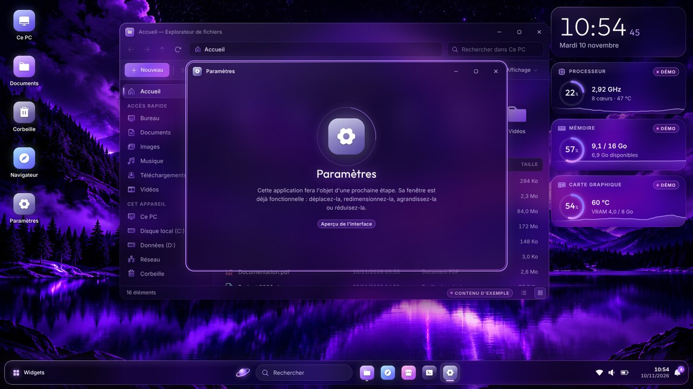

# Evolve

**Evolve** est un environnement de bureau au style néon violet : bureau, barre des tâches, menu Démarrer, fenêtres, explorateur de fichiers.

Cette version 0.1.0 est un **aperçu de l'interface graphique**. Elle prend la forme d'un simple fichier `.exe` portable pour Windows : il s'ouvre comme une application ordinaire, sans installation, et ne modifie rien sur le PC.


| Menu Démarrer | Fenêtres et explorateur de fichiers |
| :---: | :---: |
|  |  |

## Sommaire

- [Télécharger et lancer Evolve](#télécharger-et-lancer-evolve)
- [Ce qu'Evolve fait — et ne fait pas — sur votre PC](#ce-quevolve-fait--et-ne-fait-pas--sur-votre-pc)
- [Ce que contient cet aperçu](#ce-que-contient-cet-aperçu)
- [Raccourcis utiles](#raccourcis-utiles)
- [Vérifications automatiques](#vérifications-automatiques)
- [Limites connues](#limites-connues)
- [Développement](#développement)
- [Crédits et licences](#crédits-et-licences)

## Télécharger et lancer Evolve

L'exécutable est fabriqué automatiquement par GitHub à chaque modification du code.

1. Connectez-vous à GitHub, puis ouvrez la page **[Actions → Exécutable Windows](https://github.com/leoblanchart92-hub/Evolve/actions/workflows/build-windows.yml)**.
2. Cliquez sur l'exécution la plus récente marquée d'une coche verte.
3. En bas de la page, dans la rubrique **Artifacts**, cliquez sur **`Evolve-0.1.0-portable.exe`** : le fichier (environ 140 Mo) se télécharge tel quel, sans archive à décompresser.
4. Double-cliquez sur le fichier téléchargé. Evolve s'ouvre en plein écran.

À savoir :

- **Avertissement de Windows.** Le fichier n'est pas signé numériquement (une signature est payante). Le navigateur peut donc signaler un fichier « rarement téléchargé », et Windows afficher « Windows a protégé votre ordinateur » : cliquez sur *Informations complémentaires*, puis sur *Exécuter quand même*.
- **Démarrage.** Au lancement, le fichier se décompresse dans le dossier temporaire avant d'afficher quoi que ce soit : comptez quelques secondes sans rien à l'écran. Il est inutile de le lancer une seconde fois.
- **Quitter.** Menu Démarrer → bouton d'alimentation (en bas à droite du menu) → *Quitter Evolve*, ou `Alt` + `F4`.
- **Durée de disponibilité.** GitHub conserve chaque exécutable 90 jours. Passé ce délai, il suffit d'une nouvelle compilation pour en obtenir un autre.

Configuration requise : Windows 10 ou 11, 64 bits.

## Ce qu'Evolve fait — et ne fait pas — sur votre PC

| Engagement | En pratique |
| --- | --- |
| **Aucune installation** | Rien n'est ajouté au menu Démarrer de Windows, au bureau, à la liste des programmes ni au démarrage de l'ordinateur. Pour « désinstaller » Evolve, supprimez le fichier `.exe`. |
| **Aucun droit administrateur** | Evolve s'exécute avec les droits de l'utilisateur et ne déclenche jamais la demande d'élévation de Windows. Ce point est contrôlé à chaque compilation. |
| **Aucun fichier personnel lu ou modifié** | L'explorateur de fichiers présente un contenu d'exemple, fictif. Vos documents ne sont ni parcourus, ni affichés, ni modifiés. |
| **Aucun réglage de Windows modifié** | Les paramètres rapides (Wi-Fi, Bluetooth, volume, luminosité…) sont purement visuels : ils n'agissent que sur l'interface d'Evolve. |
| **Aucune mesure réelle du matériel** | Les widgets processeur, mémoire et carte graphique affichent des valeurs simulées, signalées par la mention « DÉMO ». |
| **Aucune connexion réseau** | L'interface est entièrement locale ; toute requête vers Internet y est bloquée. |

**Fichiers temporaires.** Evolve ne crée aucun dossier à son nom dans votre profil (`AppData\Roaming`, `AppData\Local`), là où les applications installées rangent leurs données. Il n'utilise que le dossier temporaire de Windows (`%TEMP%`) :

| Dossier dans `%TEMP%` | Contenu | Taille | Durée de vie |
| --- | --- | --- | --- |
| `Evolve-portable` | l'application décompressée | environ 315 Mo | créé au lancement, supprimé à la fermeture |
| `ns….tmp` (nom variable) | dossier de travail du lanceur | moins de 1 Mo | créé au lancement, supprimé à la fermeture |
| `Evolve` | cache technique du moteur d'affichage | environ 3 Mo | conservé d'un lancement à l'autre |

Ces dossiers peuvent être supprimés sans risque lorsqu'Evolve est fermé. Leur taille et leur suppression à la fermeture sont relevées à chaque compilation (voir [Vérifications automatiques](#vérifications-automatiques)).

## Ce que contient cet aperçu

- **Bureau** — fond d'écran officiel du projet, icônes (double-clic pour ouvrir), menu contextuel au clic droit.
- **Barre des tâches** — bouton Démarrer, recherche, applications épinglées avec témoin d'activité, zone de notification, horloge ; clic droit sur une application pour la réduire ou la fermer.
- **Menu Démarrer** — applications épinglées, liste de toutes les applications, éléments recommandés et recherche instantanée (applications, fichiers d'exemple, paramètres).
- **Paramètres rapides** et **centre de notifications** avec calendrier.
- **Widgets** — horloge, processeur, mémoire et carte graphique (valeurs de démonstration), masquables depuis le bouton *Widgets*.
- **Fenêtres** — déplacement, redimensionnement par les bords et les coins, agrandissement, réduction dans la barre des tâches, superposition de plusieurs fenêtres.
- **Explorateur de fichiers** — navigation dans une arborescence d'exemple, volet latéral, affichage en grille ou en liste, tri, filtre, sélection multiple, navigation au clavier.
- **Adaptation à l'écran** — de 1024 × 768 à la 4K ; les animations sont réduites si Windows est réglé pour les limiter.

Les autres applications (Navigateur, Paramètres, Terminal…) ouvrent pour l'instant une fenêtre d'attente : elles feront l'objet des prochaines étapes.

## Raccourcis utiles

| Action | Raccourci |
| --- | --- |
| Quitter Evolve | `Alt` + `F4` |
| Basculer le plein écran | `F11` |
| Fermer un menu ou un panneau | `Échap` |
| Chercher depuis le menu Démarrer | ouvrir le menu, puis taper directement |
| Agrandir ou restaurer une fenêtre | double-clic sur sa barre de titre |
| Explorateur : précédent, suivant, dossier parent | `Alt` + `←`, `Alt` + `→`, `Alt` + `↑` |

Le fichier `.exe` accepte aussi des options, à ajouter après son nom dans une invite de commandes ou dans un raccourci :

| Option | Effet |
| --- | --- |
| `--windowed` | démarre dans une fenêtre plutôt qu'en plein écran |
| `--devtools` | autorise les outils de développement (touche `F12`) |
| `--self-test` | lance l'auto-test décrit ci-dessous, puis quitte ; le rapport est enregistré dans un dossier `self-test-output` créé à côté du fichier `.exe` |
| `--status-file=FICHIER` | une fois l'interface démarrée, écrit dans `FICHIER` l'état de la fenêtre et enregistre à côté l'image affichée ; sert à la vérification du lancement décrite ci-dessous |

## Vérifications automatiques

Evolve ne pouvant pas être essayé à la main à chaque modification, la compilation ([`.github/workflows/build-windows.yml`](.github/workflows/build-windows.yml)) contrôle elle-même le résultat, sur une machine Windows de GitHub :

1. **Tests automatiques** du code (`npm test`).
2. **Fabrication** du fichier `.exe` portable.
3. **Droits demandés** : lecture du manifeste de l'exécutable, qui doit indiquer le niveau `asInvoker` (aucun droit administrateur).
4. **Auto-test** : le `.exe` est réellement lancé avec l'option `--self-test`. L'application vérifie alors son propre affichage — fond d'écran identique à l'image d'origine, polices, barre des tâches, menu Démarrer, recherche, panneaux, fenêtres, explorateur, absence d'erreur — et enregistre un rapport accompagné de captures d'écran.
5. **Lancement normal** : le `.exe` est lancé une seconde fois, sans option d'essai, comme par un double-clic. Un contrôle extérieur vérifie que la fenêtre s'ouvre en plein écran et couvre tout l'écran, compare une capture de l'écran à l'image dessinée par l'application, puis demande la fermeture comme le ferait `Alt` + `F4` : l'application doit se fermer sans erreur, et sans avoir créé de dossier dans le profil de l'utilisateur. L'espace occupé dans le dossier temporaire, et ce qu'il en reste après la fermeture, sont relevés.

Le fichier `.exe` n'est publié que si toutes ces étapes réussissent. Les rapports et les captures d'écran sont joints à chaque exécution, dans l'artefact `auto-test` ; l'essentiel est résumé en tête de la page de l'exécution.

## Limites connues

- Cet aperçu est une application qui *ressemble* à un environnement de bureau : il ne remplace pas le bureau de Windows et ne lance pas de vrais programmes.
- Seul l'explorateur de fichiers est fonctionnel, sur un contenu d'exemple ; ses actions sur les fichiers (nouveau, renommer, supprimer…) ne sont pas encore disponibles.
- L'interface est en français uniquement.
- L'exécutable n'est pas signé (voir l'avertissement de Windows ci-dessus) et n'existe que pour Windows 64 bits.
- Si Evolve est interrompu brutalement (gestionnaire des tâches, coupure de courant), des fichiers temporaires peuvent subsister dans `%TEMP%` (dossiers `Evolve-portable` et `ns….tmp`). Ils peuvent être supprimés à la main.

## Développement

Prérequis : [Node.js](https://nodejs.org) 22.12 ou plus récent.

```bash
npm ci                 # installe les dépendances (Electron, electron-builder)
npm start              # lance Evolve en plein écran
npm run start:windowed # lance Evolve dans une fenêtre
npm run preview        # aperçu de l'interface dans un navigateur (http://localhost:4173)
npm test               # tests automatiques
npm run build:win      # fabrique dist/Evolve-<version>-portable.exe (sous Windows)
npm run check:manifest # vérifie que l'exécutable ne demande aucun droit administrateur
npm run check:exe      # lance l'auto-test de l'exécutable fabriqué
npm run check:launch   # lance l'exécutable normalement et vérifie plein écran, affichage et fermeture
npm run check:dev      # lance l'auto-test de la version de développement
npm run icons          # régénère la planche de pictogrammes
```

L'interface est écrite en HTML, CSS et JavaScript, sans bibliothèque ni étape de compilation ; [Electron](https://www.electronjs.org) l'affiche dans une fenêtre de bureau.

```text
assets/          fond d'écran, polices, icône de l'application
src/main/        application de bureau (Electron) : fenêtre, sécurité, auto-test
src/renderer/    interface : page, feuilles de style et modules JavaScript
  js/core/       outils communs (DOM, formats, horloge, pictogrammes)
  js/shell/      bureau, barre des tâches, menu Démarrer, panneaux
  js/wm/         gestionnaire de fenêtres
  js/widgets/    widgets matériels (processeur, mémoire, carte graphique)
  js/apps/       applications (explorateur de fichiers)
  js/data/       applications et contenus de démonstration
scripts/         outils : aperçu, pictogrammes, vérifications de l'exécutable
tests/           tests automatiques
packaging/       icône de l'exécutable
```

Le nom du produit et son numéro de version affichés dans l'interface sont définis dans [`src/renderer/js/config.js`](src/renderer/js/config.js).

## Crédits et licences

- Fond d'écran : image fournie par l'auteur du projet, intégrée sans aucune modification.
- Pictogrammes : [Phosphor Icons](https://phosphoricons.com) (licence MIT).
- Polices : [Inter](https://github.com/rsms/inter) et [Outfit](https://github.com/Outfitio/Outfit-Fonts) (SIL Open Font License 1.1).
- Moteur : [Electron](https://www.electronjs.org) ; exécutable portable fabriqué avec [electron-builder](https://www.electron.build).

Le détail des licences figure dans [`THIRD-PARTY-NOTICES.md`](THIRD-PARTY-NOTICES.md).
