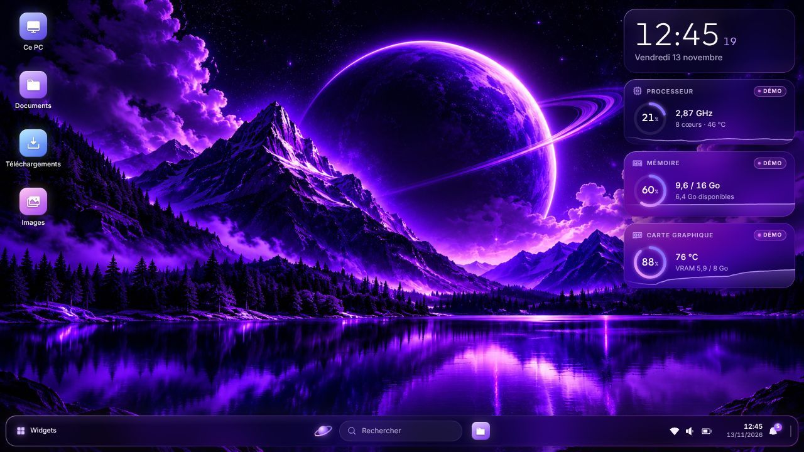
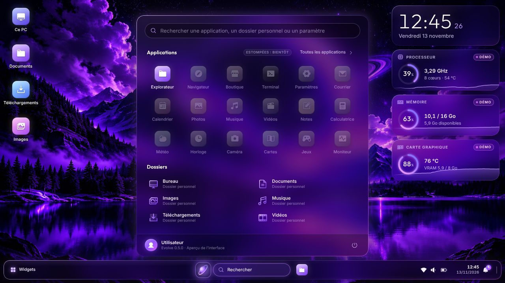
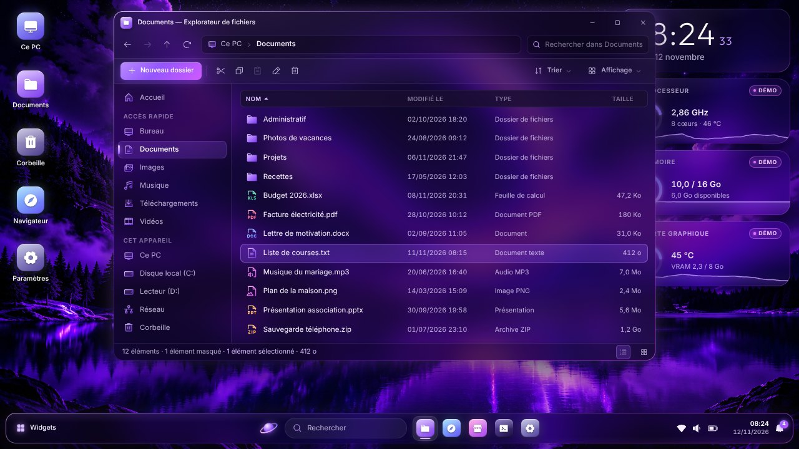

# Evolve

**Evolve** est un environnement de bureau au style néon violet : bureau, barre des tâches, menu Démarrer, fenêtres, explorateur de fichiers.

Cette version 0.4.0 reste un **aperçu de l'interface graphique**, avec deux fonctions réelles : son **explorateur de fichiers affiche les vrais dossiers de votre ordinateur, en lecture seule** — il ne crée, ne modifie, ne déplace, ne supprime et n'ouvre aucun fichier —, et ses **Paramètres** décrivent la version installée, ouvrent les dossiers qu'elle utilise et [recherchent les mises à jour](#mises-à-jour).

Evolve se présente sous **trois formes**, à choisir au moment du téléchargement : un **programme d'installation** qui l'ajoute à votre menu Démarrer sans demander le mot de passe de l'ordinateur, un second qui l'installe pour **tous les utilisateurs** de la machine, et un **fichier `.exe` portable** qui s'ouvre sans rien installer. Les trois, ainsi qu'une [image `.iso`](#limage-iso) qui les rassemble, sont fabriqués à chaque modification du code. Ce qu'Evolve écrit sur le PC se limite à un petit fichier de réglages et à des fichiers temporaires, [détaillés plus bas](#ce-quevolve-fait--et-ne-fait-pas--sur-votre-pc).



| Menu Démarrer | Explorateur de fichiers |
| :---: | :---: |
|  |  |

*Captures réalisées sur un disque de démonstration.*

## Sommaire

- [Télécharger et lancer Evolve](#télécharger-et-lancer-evolve)
- [Installer Evolve](#installer-evolve)
- [Mises à jour](#mises-à-jour)
- [L'image .iso](#limage-iso)
- [Ce qu'Evolve fait — et ne fait pas — sur votre PC](#ce-quevolve-fait--et-ne-fait-pas--sur-votre-pc)
- [L'explorateur de fichiers](#lexplorateur-de-fichiers)
- [Vos réglages](#vos-réglages)
- [Ce que contient cet aperçu](#ce-que-contient-cet-aperçu)
- [Raccourcis utiles](#raccourcis-utiles)
- [Vérifications automatiques](#vérifications-automatiques)
- [Limites connues](#limites-connues)
- [Développement](#développement)
- [Crédits et licences](#crédits-et-licences)

## Télécharger et lancer Evolve

Les fichiers sont fabriqués automatiquement par GitHub à chaque modification du code.

1. Connectez-vous à GitHub, puis ouvrez la page **[Actions → Fichiers publiés pour Windows](https://github.com/leoblanchart92-hub/Evolve/actions/workflows/build-windows.yml)**.
2. Cliquez sur l'exécution la plus récente marquée d'une coche verte.
3. En bas de la page, dans la rubrique **Artifacts**, choisissez l'un des fichiers de l'archive `Evolve-windows` :

| Fichier | Pour quoi faire | Taille |
| --- | --- | --- |
| `Evolve-0.4.0-setup.exe` | **l'installer pour vous seul** — menu Démarrer, bureau, désinstallateur ; aucun mot de passe demandé | environ 140 Mo |
| `Evolve-0.4.0-setup-tous-utilisateurs.exe` | **l'installer pour tous les comptes** de la machine, dans « Program Files » — Windows demande sa confirmation habituelle | environ 140 Mo |
| `Evolve-0.4.0-portable.exe` | **l'essayer sans rien installer** : le fichier s'ouvre comme une application ordinaire | environ 140 Mo |
| `Evolve-0.4.0.iso` | une **image disque** qui contient les trois fichiers ci-dessus, leurs empreintes et ce document (voir [L'image .iso](#limage-iso)) | environ 420 Mo |
| `SHA256SUMS.txt` | les **empreintes** des quatre fichiers, pour vérifier un téléchargement | moins de 1 Ko |

4. Double-cliquez sur le fichier téléchargé.

Les fichiers se téléchargent tels quels, sans archive à décompresser. Aucun n'est signé numériquement — une signature est payante —, aussi Windows affiche-t-il « Windows a protégé votre ordinateur » : cliquez sur *Informations complémentaires*, puis sur *Exécuter quand même*. Le navigateur peut lui aussi signaler un fichier « rarement téléchargé ».

À savoir :

- **Démarrage.** L'exécutable portable se décompresse dans le dossier temporaire avant d'afficher quoi que ce soit : comptez quelques secondes sans rien à l'écran. Il est inutile de le lancer une seconde fois. Une version installée démarre directement.
- **Quitter.** Menu Démarrer → bouton d'alimentation (en bas à droite du menu) → *Quitter Evolve*, ou `Alt` + `F4`.
- **Durée de disponibilité.** GitHub conserve chaque fichier 90 jours. Passé ce délai, il suffit d'une nouvelle compilation pour en obtenir d'autres.

Configuration requise : Windows 10 ou 11, 64 bits.

## Installer Evolve

Deux programmes d'installation sont proposés ; ils affichent un assistant en français, avec le dossier d'installation et les raccourcis visibles.

| | `Evolve-0.4.0-setup.exe` | `Evolve-0.4.0-setup-tous-utilisateurs.exe` |
| --- | --- | --- |
| Pour qui | vous seul | tous les comptes de la machine |
| Où | `%LOCALAPPDATA%\Programs\Evolve` | `C:\Program Files\Evolve` |
| Mot de passe | **aucun demandé** | Windows affiche sa confirmation habituelle |
| Raccourcis | menu Démarrer et bureau | menu Démarrer et bureau |
| Désinstallateur | oui | oui |

Installer Evolve ne change rien au reste : aucun réglage de Windows n'est modifié, rien n'est ajouté au démarrage de l'ordinateur. C'est seulement l'application, ses raccourcis et son désinstallateur qui apparaissent.

**Désinstaller.** Paramètres Windows → Applications → Evolve → Désinstaller. Vos réglages (`%APPDATA%\Evolve`) sont **conservés** : réinstaller Evolve plus tard les retrouve. Pour repartir vraiment de zéro, supprimez aussi ce dossier. La compilation vérifie ce point sur une machine Windows à chaque modification du code : après une installation silencieuse, l'application installée passe l'auto-test, puis elle est désinstallée — et plus rien ne doit subsister, réglages exceptés.

**Version portable.** Aucune installation : supprimez le fichier `.exe`, et il ne reste rien.

## Mises à jour

La page **Paramètres → Mises à jour** indique la version installée, recherche la dernière version publiée et l'installe.

- **Ce qui est contacté.** Une seule adresse : `api.github.com`, puis `github.com` pour le téléchargement — rien d'autre, et uniquement quand vous le demandez, ou au démarrage si vous avez laissé « Vérifier au démarrage » activé (c'est le réglage par défaut). Aucune information sur vous n'est envoyée ; Evolve ne consulte que la liste des versions publiées du projet.
- **Ce qui est téléchargé.** Un seul fichier, celui de votre forme d'installation : `Evolve-<version>-portable.exe`, `Evolve-<version>-setup.exe` ou `Evolve-…tous-utilisateurs.exe`. Il est d'abord enregistré dans le dossier temporaire (`%TEMP%\Evolve-mise-a-jour`), puis **son empreinte SHA-256 est comparée à celle publiée à côté de lui** (`SHA256SUMS.txt`). Si elle ne correspond pas, le fichier est supprimé et rien n'est installé : une mise à jour n'est jamais appliquée sans cette vérification.
- **Ce qui se passe ensuite.** Version installée : Evolve lance le programme d'installation téléchargé en mode silencieux (`/S --updated`) et se ferme ; l'installation pour tous les utilisateurs demande, elle, la confirmation de Windows. Version portable : Evolve ne peut pas s'installer lui-même — le bouton ouvre la page des versions du projet, d'où vous téléchargez le nouveau fichier.
- **Vérification au démarrage.** Elle est silencieuse : aucun message si aucune version nouvelle n'est publiée. Le réglage « Vérifier au démarrage » la désactive ; sans connexion, la vérification échoue sans conséquence, et Evolve continue de fonctionner.
- **Pendant l'auto-test et les vérifications de la compilation**, les mises à jour ne sont jamais activées : aucun de ces lancements ne contacte quoi que ce soit.

## L'image .iso

`Evolve-0.4.0.iso` est une image disque (ISO 9660 avec extensions Joliet, lisible par Windows, macOS et Linux) qui rassemble :

```text
Evolve-0.4.0-portable.exe                      l'exécutable portable
Evolve-0.4.0-setup.exe                         l'installation pour vous seul
Evolve-0.4.0-setup-tous-utilisateurs.exe       l'installation pour tous les comptes
SHA256SUMS.txt                                 les empreintes des trois fichiers
LISEZ-MOI.md                                   ce document
documents/licences-tiers.md                    les licences des polices, pictogrammes et du moteur
```

Deux usages : la **graver** sur un DVD ou la copier sur une clé USB pour installer Evolve sur une machine sans la télécharger, ou la **conserver** comme archive d'une version précise. Sous Windows 10 et 11, un double-clic sur le fichier `.iso` le monte comme un lecteur ; sinon, un clic droit → *Graver l'image disque*.

L'image n'est pas amorçable : elle ne démarre pas un ordinateur, elle n'est qu'un contenant. Le fichier d'empreintes qu'elle renferme ne peut pas contenir l'empreinte de l'image elle-même — celle-ci figure dans le `SHA256SUMS.txt` publié à côté, qui couvre les quatre fichiers.

## Ce qu'Evolve fait — et ne fait pas — sur votre PC

| Engagement | En pratique |
| --- | --- |
| **Installation facultative** | L'exécutable portable ne s'installe pas : supprimez le fichier `.exe`, et il ne reste rien. Les deux programmes d'installation n'ajoutent que l'application, deux raccourcis et un désinstallateur : rien dans la liste des programmes de Windows au-delà d'Evolve, rien au démarrage de l'ordinateur, aucun réglage de Windows modifié. Vos réglages survivent à une désinstallation. |
| **Aucun droit administrateur** | Evolve s'exécute avec les droits de l'utilisateur et ne déclenche jamais lui-même la demande d'élévation de Windows. Seule l'installation pour tous les utilisateurs la déclenche — « Program Files » n'est pas accessible autrement : c'est Windows qui la demande, à l'installation, et elle est signalée comme telle. Ces deux points sont lus dans le manifeste de chaque fichier à chaque compilation. |
| **Vos fichiers : consultés, jamais modifiés** | L'explorateur affiche le contenu des dossiers que vous ouvrez — noms, types, tailles, dates — sans jamais lire le contenu d'un fichier. Il ne crée, ne modifie, ne déplace, ne supprime et n'ouvre rien : ces opérations n'existent pas dans le programme. Un dossier personnel absent — Documents compris — est annoncé comme introuvable, jamais recréé. Ce que vous consultez n'est ni enregistré ni transmis (voir [L'explorateur de fichiers](#lexplorateur-de-fichiers)). Ces points sont contrôlés à chaque compilation. |
| **Aucun réglage de Windows modifié** | Les paramètres rapides (Wi-Fi, Bluetooth, volume, luminosité…) sont purement visuels : ils n'agissent que sur l'interface d'Evolve, qui retient leur position sans rien changer à Windows. |
| **Un seul dossier dans votre profil** | Evolve n'y range que vos réglages : le fichier `%APPDATA%\Evolve\settings.json` (voir [Vos réglages](#vos-réglages)). Il n'est créé qu'au premier réglage modifié : tant que vous ne changez rien, Evolve n'écrit rien dans votre profil. Ces deux points sont contrôlés à chaque compilation. |
| **Aucune mesure réelle du matériel** | Les widgets processeur, mémoire et carte graphique affichent des valeurs simulées, signalées par la mention « DÉMO ». |
| **Aucune connexion réseau, hors mises à jour** | L'interface est entièrement locale : toute autre requête vers Internet y est bloquée. Seul le service des mises à jour parle au serveur du projet, uniquement vers `github.com`, et seulement pour [les mises à jour](#mises-à-jour) — jamais pendant les vérifications automatiques. |

**Fichiers temporaires.** En dehors du fichier de réglages décrit ci-dessous, Evolve n'utilise que le dossier temporaire de Windows (`%TEMP%`) :

| Dossier dans `%TEMP%` | Contenu | Taille | Durée de vie |
| --- | --- | --- | --- |
| `Evolve-portable` | l'application décompressée (**exécutable portable uniquement**) | environ 315 Mo | créé au lancement, supprimé à la fermeture |
| `ns….tmp` (nom variable) | dossier de travail du lanceur (**exécutable portable uniquement**) | moins de 1 Mo | créé au lancement, supprimé à la fermeture |
| `Evolve` | cache technique du moteur d'affichage | environ 3 Mo | conservé d'un lancement à l'autre |
| `Evolve-mise-a-jour` | fichier d'installation téléchargé, le temps de la vérification de son empreinte | environ 140 Mo | supprimé dès l'installation lancée, ou à la fermeture |

Ces dossiers peuvent être supprimés sans risque lorsqu'Evolve est fermé. Leur taille et leur suppression à la fermeture sont relevées à chaque compilation (voir [Vérifications automatiques](#vérifications-automatiques)).

## L'explorateur de fichiers

L'explorateur d'Evolve parcourt les vrais dossiers de l'ordinateur, **en lecture seule**.

Ce qu'il affiche :

- **Accueil** et **Ce PC** — vos six dossiers personnels (Bureau, Documents, Téléchargements, Images, Musique, Vidéos), là où Windows les range réellement, même déplacés vers OneDrive, et les lecteurs locaux avec leur espace libre.
- **Le contenu de chaque dossier** — nom, type, taille et date de modification, en grandes icônes ou en vue « Détails », triable par colonne.
- **La navigation habituelle** — double-clic, fil d'Ariane cliquable (les premiers dossiers d'un long chemin se replient dans « … »), précédent, suivant, dossier parent, actualisation, recherche dans le dossier affiché, sélection et déplacement au clavier.
- **Les éléments masqués** — fichiers du système, `AppData`, `desktop.ini`… restent cachés, comme dans l'Explorateur de Windows ; *Affichage → Éléments masqués* les montre, estompés.

Ce qu'il ne fait pas, par construction :

- **Aucune opération sur les fichiers.** Les boutons *Nouveau*, *Couper*, *Copier*, *Renommer*, *Supprimer*… sont présents, mais annoncent seulement que l'opération arrivera dans une prochaine étape. Un double-clic sur un fichier ne l'ouvre pas.
- **Aucune lecture du contenu des fichiers.** Le service qui lit les dossiers ([`src/services/files.js`](src/services/files.js)) ne répond qu'à deux demandes — la liste des emplacements et le contenu d'un dossier — et n'utilise que quatre fonctions de lecture du système : ouvrir un dossier, lire les propriétés d'un élément, résoudre un chemin, lire la capacité d'un lecteur.
- **Rien en dehors des emplacements autorisés** : les six dossiers personnels et les lecteurs locaux. Chaque chemin demandé est contrôlé avant tout accès au disque : chemins relatifs, remontées (`..`), partages réseau (`\\serveur\…`) et chemins spéciaux de Windows sont refusés. Un lien ou une jonction qui mène hors de ces emplacements n'est pas suivi.
- **Aucune création de dossier.** Si l'un de vos dossiers personnels n'existe pas, ou plus — Documents, par exemple, supprimé ou resté sur un disque débranché —, sa tuile est estompée et son ouverture affiche « Dossier « Documents » introuvable », en précisant que rien n'a été modifié. Evolve ne le recrée pas : un dossier absent reste absent. Si vous le remettez en place, *Actualiser* le fait réapparaître — à défaut, fermez puis rouvrez Evolve.
- **Aucune demande de droits.** Un dossier protégé par Windows affiche « Accès refusé » ; un dossier supprimé entre-temps ou un lecteur retiré, « Dossier introuvable » ou « Emplacement indisponible ». Dans tous les cas, la navigation continue.

Ce qui le distingue encore de l'Explorateur de Windows est détaillé dans les [limites connues](#limites-connues).

## Vos réglages

Evolve retient d'un lancement à l'autre :

- l'affichage des **widgets** et des **icônes du bureau** (affichés ou masqués) ;
- la position des **paramètres rapides** : Wi-Fi, Bluetooth, mode avion, économie d'énergie, éclairage nocturne, « Ne pas déranger », luminosité, volume et son coupé ;
- la **vérification des mises à jour au démarrage** (activée ou non, page *Mises à jour*).

Ils sont rangés dans le dossier `%APPDATA%\Evolve` — c'est-à-dire `C:\Users\<votre nom>\AppData\Roaming\Evolve` ; pour l'ouvrir, collez `%APPDATA%\Evolve` dans la barre d'adresse de l'explorateur de Windows.

| Fichier dans `%APPDATA%\Evolve` | Contenu | Durée de vie |
| --- | --- | --- |
| `settings.json` | les réglages que vous avez modifiés, en texte lisible (moins de 1 Ko) | créé au premier réglage modifié, conservé ensuite |
| `settings.corrupt.json` | copie d'un fichier de réglages devenu inutilisable | n'existe qu'après un incident (voir ci-dessous) |
| `settings.json.tmp` | enregistrement en cours | un instant, pendant l'enregistrement |

À savoir :

- **Enregistrement.** Un réglage modifié est enregistré dans la seconde qui suit ; un changement encore en attente l'est à la fermeture d'Evolve ou à l'extinction de Windows. Le fichier est remplacé en une seule opération, pour qu'une coupure de courant laisse soit l'ancienne version, soit la nouvelle, et non un fichier tronqué.
- **Revenir aux réglages d'origine.** Fermez Evolve, puis supprimez `settings.json` (ou le dossier `%APPDATA%\Evolve` entier).
- **Fichier endommagé.** Si `settings.json` est devenu inutilisable (modification à la main, disque défaillant), Evolve démarre avec les réglages d'origine, vous en informe, et met le fichier de côté sous le nom `settings.corrupt.json` au lieu de le perdre. Une valeur isolée invalide reprend simplement sa valeur d'origine.
- **Fichier inaccessible.** Si le fichier ne peut pas être lu ou écrit (droits insuffisants, disque plein), Evolve fonctionne normalement et vous prévient que vos changements risquent de ne pas être conservés. Un fichier qu'il n'a pas pu lire n'est jamais écrasé.
- **Changement de version.** Les réglages enregistrés par une version plus récente d'Evolve ne sont pas perdus si vous relancez une version plus ancienne : ceux qu'elle ne connaît pas sont conservés tels quels.

Avec l'option `--settings-dir=DOSSIER` (voir [Raccourcis utiles](#raccourcis-utiles)), les réglages sont rangés dans le dossier de votre choix plutôt que dans votre profil. Un chemin relatif part du dossier où se trouve le fichier `.exe` : `--settings-dir=reglages` range ainsi les réglages à côté de lui, par exemple sur une clé USB.

## Ce que contient cet aperçu

Deux applications sont réellement fonctionnelles ; aucune autre n'est présente — Evolve ne montre pas d'application qui ne fonctionne pas.

- **Explorateur de fichiers** — vos vrais dossiers, en lecture seule : dossiers personnels et lecteurs, volet latéral, grandes icônes ou vue « Détails », tri, recherche dans le dossier, sélection multiple, navigation au clavier (voir [L'explorateur de fichiers](#lexplorateur-de-fichiers)).
- **Paramètres** — cinq pages : **Système** (version installée, forme de l'installation, dossiers utilisés, tous ouvrables d'un clic), **Bureau** (widgets et icônes), **Réseau et son** (paramètres rapides), **Mises à jour** (voir [Mises à jour](#mises-à-jour)) et **Réinitialiser** (revenir aux réglages d'origine, et comment désinstaller).

Le reste de l'environnement :

- **Bureau** — fond d'écran officiel du projet, icônes (double-clic pour ouvrir), menu contextuel au clic droit.
- **Barre des tâches** — bouton Démarrer, recherche, applications épinglées avec témoin d'activité, zone de notification, horloge ; clic droit sur une application pour la réduire ou la fermer.
- **Menu Démarrer** — applications épinglées, liste de toutes les applications, éléments recommandés (des exemples) et recherche instantanée : applications, dossiers personnels, fichiers d'exemple, paramètres.
- **Paramètres rapides** et **centre de notifications** avec calendrier.
- **Widgets** — horloge, processeur, mémoire et carte graphique (valeurs de démonstration), masquables depuis le bouton *Widgets*.
- **Fenêtres** — déplacement, redimensionnement par les bords et les coins, agrandissement, réduction dans la barre des tâches, superposition de plusieurs fenêtres.
- **Adaptation à l'écran** — de 1024 × 768 à la 4K ; les animations sont réduites si Windows est réglé pour les limiter.

## Raccourcis utiles

| Action | Raccourci |
| --- | --- |
| Quitter Evolve | `Alt` + `F4` |
| Basculer le plein écran | `F11` |
| Fermer un menu ou un panneau | `Échap` |
| Chercher depuis le menu Démarrer | ouvrir le menu, puis taper directement |
| Agrandir ou restaurer une fenêtre | double-clic sur sa barre de titre |
| Explorateur : précédent, suivant, dossier parent | `Alt` + `←`, `Alt` + `→`, `Alt` + `↑` |
| Explorateur : actualiser le dossier affiché | `F5` |
| Explorateur : rechercher dans le dossier affiché | `Ctrl` + `F` |

Le fichier `.exe` accepte aussi des options, à ajouter après son nom dans une invite de commandes ou dans un raccourci :

| Option | Effet |
| --- | --- |
| `--windowed` | démarre dans une fenêtre plutôt qu'en plein écran |
| `--devtools` | autorise les outils de développement (touche `F12`) |
| `--settings-dir=DOSSIER` | range les réglages dans `DOSSIER` au lieu de `%APPDATA%\Evolve` ; le dossier est créé au premier réglage modifié (voir [Vos réglages](#vos-réglages)) |
| `--self-test` | lance l'auto-test décrit ci-dessous, puis quitte ; le rapport, les captures d'écran et le petit dossier d'essai de l'explorateur sont enregistrés dans un dossier `self-test-output` créé à côté du fichier `.exe`. Pendant l'auto-test, les réglages restent en mémoire : vos réglages ne sont ni lus ni modifiés |
| `--self-test-scenario=NOM` | avec `--self-test`, choisit ce qui est contrôlé : `full` (par défaut, le contrôle complet), ou `settings-write` puis `settings-read`, les deux lancements de la vérification des réglages décrite ci-dessous (ils exigent `--settings-dir`) |
| `--status-file=FICHIER` | une fois l'interface démarrée, écrit dans `FICHIER` l'état de la fenêtre et enregistre à côté l'image affichée ; sert à la vérification du lancement décrite ci-dessous |

## Vérifications automatiques

Evolve ne pouvant pas être essayé à la main à chaque modification, la compilation ([`.github/workflows/build-windows.yml`](.github/workflows/build-windows.yml)) contrôle elle-même le résultat, sur une machine Windows de GitHub :

1. **Tests automatiques** du code (`npm test`).
2. **Fabrication** de l'exécutable portable et des deux programmes d'installation.
3. **Droits demandés** : lecture du manifeste de chaque fichier. L'exécutable portable, l'application qu'il contient et l'installation pour vous seul doivent indiquer le niveau `asInvoker` (aucun droit administrateur) ; seule l'installation pour tous les utilisateurs doit demander l'élévation.
4. **Empreintes et image** : les empreintes SHA-256 des trois exécutables sont relevées, l'image `.iso` est fabriquée et vérifiée (elle est ensuite relue : chaque fichier doit en ressortir à l'identique), puis le fichier `SHA256SUMS.txt` est complété avec l'empreinte de l'image.
5. **Auto-test** : le `.exe` est réellement lancé avec l'option `--self-test`. L'application vérifie alors son propre affichage — fond d'écran identique à l'image d'origine, polices, barre des tâches, menu Démarrer, recherche, panneaux, fenêtres, services joignables depuis l'interface, absence d'erreur — et enregistre un rapport accompagné de captures d'écran. Elle met aussi l'**explorateur** à l'épreuve sur de vrais dossiers : elle crée un petit dossier d'essai dans son dossier de résultats, s'y rend comme le ferait un utilisateur (« Ce PC », le lecteur, puis chaque dossier au double-clic) et contrôle les noms, les types, les tailles et les dates affichés, la navigation, l'actualisation, puis le message « Dossier introuvable » devant un dossier supprimé entre-temps. Devant un dossier protégé de Windows, elle attend « Accès refusé » ; sur la machine de GitHub, dont le compte peut tout lire, aucun dossier ne refuse l'accès : ce contrôle-là y est omis (un avertissement le signale dans le rapport), et le refus d'accès n'est vérifié que par les tests automatiques, sur un disque simulé. Elle présente ensuite au service de fichiers des chemins interdits et des demandes d'écriture, qui doivent tous être refusés, et vérifie pour finir que rien n'a changé dans le dossier parcouru.
6. **Lancement normal** : le `.exe` est lancé une seconde fois, sans option d'essai, comme par un double-clic. Un contrôle extérieur vérifie que la fenêtre s'ouvre en plein écran et couvre tout l'écran, compare une capture de l'écran à l'image dessinée par l'application, puis demande la fermeture comme le ferait `Alt` + `F4` : l'application doit se fermer sans erreur. Il vérifie aussi que les réglages sont bien destinés à `%APPDATA%\Evolve\settings.json` et que ce lancement, où aucun réglage n'est modifié, n'a rien écrit dans le profil de l'utilisateur : ni fichier, ni dossier. L'espace occupé dans le dossier temporaire, et ce qu'il en reste après la fermeture, sont relevés.
7. **Réglages et redémarrage** : le `.exe` est lancé deux fois de suite sur le véritable dossier `%APPDATA%\Evolve` de la machine. Au premier lancement, l'application modifie cinq réglages depuis son interface, par les mêmes boutons et curseurs qu'un utilisateur, puis se ferme. Le contrôle lit alors lui-même `settings.json` : le fichier doit exister, être seul dans son dossier et contenir exactement ces cinq réglages. Au second lancement, l'interface doit les afficher sans aucune action — widgets masqués, éclairage nocturne et « Ne pas déranger » activés, luminosité et volume réglés —, et relire le fichier ne doit pas le modifier. Le fichier est ensuite retiré de la machine.
8. **Dossier Documents absent** : le dossier Documents du compte de la machine est mis de côté — renommé, sans que son contenu soit touché —, de sorte que Windows n'en connaît plus aucun. Le `.exe` est alors lancé et ouvre ce dossier comme le ferait un utilisateur, depuis l'accueil de l'explorateur, le volet latéral puis l'icône du bureau : il doit afficher chaque fois « Dossier « Documents » introuvable », y compris après *Actualiser*, et la navigation doit continuer. Le contrôle constate ensuite lui-même, sur le disque, que le dossier est toujours absent, que rien n'est apparu à côté de lui et que le contenu mis de côté est intact, puis il remet le dossier en place.

9. **Installation et désinstallation** : le programme d'installation pour l'utilisateur courant est lancé en silence. L'application installée — dans `%LOCALAPPDATA%\Programs\Evolve`, avec ses deux raccourcis et son désinstallateur — passe alors l'auto-test, puis elle est désinstallée en silence : plus rien ne doit subsister, ni dossier d'installation, ni raccourci, et les réglages de l'utilisateur doivent avoir été conservés. L'installation pour tous les utilisateurs n'est pas essayée ainsi : la confirmation de Windows ne peut pas être donnée sur une machine où personne n'est là pour répondre — seuls ses droits demandés sont contrôlés.

Les fichiers ne sont publiés que si toutes ces étapes réussissent. Les rapports et les captures d'écran sont joints à chaque exécution, dans l'artefact `auto-test` ; l'essentiel est résumé en tête de la page de l'exécution.

## Limites connues

- Cet aperçu est une application qui *ressemble* à un environnement de bureau : il ne remplace pas le bureau de Windows et ne lance pas de vrais programmes.
- Deux applications seulement sont fonctionnelles : l'explorateur de fichiers, **en lecture seule** — il n'ouvre aucun fichier et n'effectue aucune opération (nouveau, copier, renommer, supprimer…) —, et les Paramètres. Aucune autre application n'est proposée.
- L'explorateur diffère encore de celui de Windows :
  - les dossiers portent leur nom réel sur le disque (« Users », « Program Files ») et non leur nom traduit (« Utilisateurs », « Programmes ») ; seuls les six dossiers personnels sont présentés sous leur nom français ;
  - les éléments masqués sont reconnus à leur nom et à leur emplacement, l'attribut « caché » de Windows n'étant pas lisible ici : un fichier que vous avez masqué vous-même reste affiché ;
  - les lecteurs réseau, les partages (`\\serveur\…`), les lecteurs virtuels (`subst`), les lecteurs amovibles vides et les volumes verrouillés ne sont pas listés ; « Réseau » et « Corbeille » sont annoncés comme non disponibles ;
  - un dossier de plus de 5 000 éléments n'affiche que les 5 000 premiers, et le signale ;
  - la recherche ne porte que sur le dossier affiché, pas sur ses sous-dossiers ; il n'y a ni miniatures d'images, ni saisie d'un chemin au clavier ;
  - un lecteur qui met plus de deux secondes à répondre n'apparaît qu'après *Actualiser* ; si plusieurs lettres de lecteur désignent des serveurs injoignables, les lecteurs des lettres suivantes n'apparaissent qu'une fois que Windows a renoncé à joindre ces serveurs ;
  - un dossier personnel absent, puis remis en place pendant qu'Evolve fonctionne, doit réapparaître après *Actualiser* : ce retour est contrôlé par les tests automatiques, mais il ne l'est pas sur une vraie machine Windows, contrairement à l'absence de toute création de dossier ; s'il n'apparaît pas, fermez puis rouvrez Evolve.
- Les fichiers « recommandés » du menu Démarrer et ceux que propose sa recherche restent des exemples fictifs, signalés comme tels ; seuls les dossiers personnels y mènent à un vrai dossier.
- Les paramètres rapides sont retenus, mais restent visuels : ils ne règlent ni le Wi-Fi, ni le son, ni la luminosité de Windows.
- Si Evolve est fermé en mode avion, quitter ce mode après le redémarrage réactive le Wi-Fi et le Bluetooth tous les deux, même si l'un d'eux était désactivé avant le mode avion : cet état antérieur n'est pas retenu.
- Les fenêtres ouvertes, leur position et le dossier affiché par l'explorateur ne sont pas retenus d'un lancement à l'autre.
- L'interface est en français uniquement.
- Les fichiers ne sont pas signés (voir l'avertissement de Windows ci-dessus) et n'existent que pour Windows 64 bits.
- Les mises à jour demandent une connexion à Internet et que le projet ait publié une version nouvelle : sans cela, Evolve continue de fonctionner et n'insiste pas. La version portable ne peut pas se mettre à jour toute seule : elle ouvre la page des versions.
- L'image `.iso` n'est pas amorçable : elle ne démarre pas un ordinateur.
- Si Evolve est interrompu brutalement (gestionnaire des tâches, coupure de courant), des fichiers temporaires peuvent subsister dans `%TEMP%` (dossiers `Evolve-portable` et `ns….tmp`, propres à l'exécutable portable). Ils peuvent être supprimés à la main. Un réglage modifié dans la seconde qui précède l'interruption peut ne pas avoir été enregistré.

## Développement

Prérequis : [Node.js](https://nodejs.org) 22.12 ou plus récent.

```bash
npm ci                 # installe les dépendances (Electron, electron-builder)
npm start              # lance Evolve en plein écran
npm run start:windowed # lance Evolve dans une fenêtre
npm run preview        # aperçu de l'interface dans un navigateur (http://localhost:4173)
npm test                # tests automatiques
npm run build:win       # fabrique l'exécutable portable et les deux programmes d'installation (sous Windows)
npm run build:win:portable  # … seulement l'exécutable portable
npm run build:win:user      # … seulement l'installation pour l'utilisateur courant
npm run build:win:machine   # … seulement l'installation pour tous les utilisateurs
npm run build:iso       # rassemble les fichiers publiés dans dist/Evolve-<version>.iso
npm run build:checksums # écrit dist/SHA256SUMS.txt (empreintes des fichiers publiés)
npm run check:manifest  # vérifie les droits que chaque fichier demande à Windows
npm run check:exe       # lance l'auto-test de l'exécutable fabriqué
npm run check:setup     # installe Evolve en silence, auto-test, désinstalle, vérifie qu'il ne reste rien
npm run check:launch    # lance l'exécutable normalement et vérifie plein écran, affichage et fermeture
npm run check:settings  # lance l'exécutable deux fois et vérifie que les réglages sont conservés
npm run check:documents # vérifie qu'un dossier Documents absent n'est pas recréé (machine de compilation uniquement)
npm run check:dev       # lance l'auto-test de la version de développement
npm run icons           # régénère la planche de pictogrammes
```

L'interface est écrite en HTML, CSS et JavaScript, sans bibliothèque ni étape de compilation ; [Electron](https://www.electronjs.org) l'affiche dans une fenêtre de bureau.

Tout ce qui touche à l'ordinateur passe par une **couche de services** (`src/services/`), indépendante d'Electron comme de l'interface. Chaque service s'inscrit auprès d'un point d'accès unique (`hub.js`) en déclarant ses méthodes publiques et ses événements ; l'interface, isolée dans un bac à sable, ne peut qu'appeler ces méthodes par leur nom (`services.call('settings', 'set', …)`) et recevoir ces événements — elle n'a accès ni aux fichiers ni au système. Quatre services existent : les réglages (`settings`), la consultation des dossiers en lecture seule (`files`), la description de l'installation (`system`, en lecture seule elle aussi) et les mises à jour (`updates`) ; les suivants s'ajouteront de la même façon, sans modifier ni la passerelle ni la fenêtre. Chacun reçoit de l'application de bureau ce dont il a besoin — un dossier, une adresse, une fonction de téléchargement — et s'annonce indisponible s'il ne l'a pas : la couche de services ne dépend ni d'Electron, ni du réseau, ni d'aucun paquet externe, ce que les tests automatiques vérifient fichier par fichier.

L'emplacement des dossiers personnels est demandé au moteur par [`src/main/personal-folders.js`](src/main/personal-folders.js), qui ne lui pose que des questions sans effet sur le disque. Le moteur crée en effet le dossier Documents absent dès qu'il en obtient le chemin. Sous Windows, il ne l'obtient pas : le système vérifie d'abord que le dossier existe, et répond par une erreur s'il est absent. Sur les autres systèmes (développement), le chemin lui est donné sans vérification : la question n'est donc jamais posée, et Evolve désigne lui-même le dossier `Documents` du compte. Un emplacement obtenu n'est plus redemandé de la session ; seul un dossier resté introuvable l'est de nouveau, à chaque actualisation.

```text
assets/          fond d'écran, polices, icône de l'application
src/main/        application de bureau (Electron) : fenêtre, sécurité, installation, auto-test
src/services/    services : point d'accès, réglages (schéma, fichier, emplacement), consultation des dossiers, système, mises à jour
src/renderer/    interface : page, feuilles de style et modules JavaScript
  js/core/       outils communs (DOM, formats, horloge, pictogrammes, accès aux services)
  js/shell/      bureau, barre des tâches, menu Démarrer, panneaux
  js/wm/         gestionnaire de fenêtres
  js/widgets/    widgets matériels (processeur, mémoire, carte graphique)
  js/apps/       applications (explorateur de fichiers : affichage, navigation)
  js/data/       applications et contenus de démonstration (menu Démarrer, notifications)
scripts/         outils : aperçu, pictogrammes, image .iso, empreintes, vérifications des fichiers publiés
tests/           tests automatiques
packaging/       icône de l'exécutable, réglages des deux programmes d'installation
```

Le nom du produit et son numéro de version affichés dans l'interface sont définis dans [`src/renderer/js/config.js`](src/renderer/js/config.js).

## Crédits et licences

- Fond d'écran : image fournie par l'auteur du projet, intégrée sans aucune modification.
- Pictogrammes : [Phosphor Icons](https://phosphoricons.com) (licence MIT).
- Polices : [Inter](https://github.com/rsms/inter) et [Outfit](https://github.com/Outfitio/Outfit-Fonts) (SIL Open Font License 1.1).
- Moteur : [Electron](https://www.electronjs.org) ; exécutable portable et programmes d'installation fabriqués avec [electron-builder](https://www.electron.build).

Le détail des licences figure dans [`THIRD-PARTY-NOTICES.md`](THIRD-PARTY-NOTICES.md).
